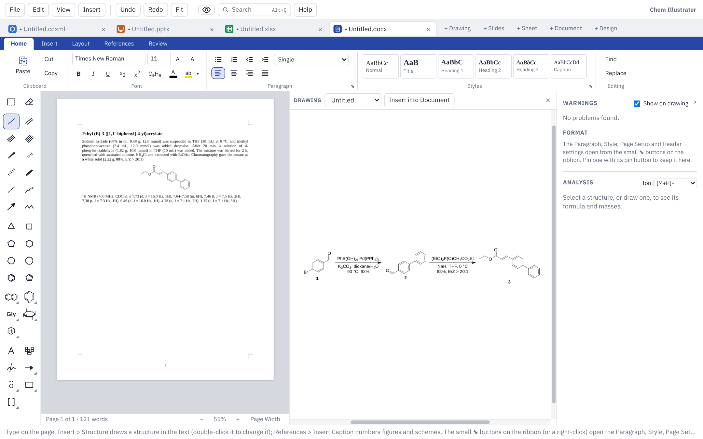

# Chem Illustrator

**Free chemical drawing for the lab, with slides, sheets and documents built in.**

Chem Illustrator draws structures and reaction schemes the way ChemDraw does, with the same hotkeys, the ACS Document 1996 look, and your existing `.cdxml` files. Around that it adds the other programs a synthetic chemist spends the day in: a PowerPoint-style slide editor, an Excel-style sheet, a Word-style document and a graphics canvas. Structures stay editable in all of them, and the chemistry (formula, masses, R/S and E/Z, warnings) is worked out as you draw.

It is free and open source (GPL v3), and runs on Windows, macOS and Linux.

**[Download the latest version](https://github.com/nathanohare/Chem-Illustrator/releases/latest)** · **[User guide](docs/README.md)** · **[Send feedback](docs/guide/feedback.md)**

## What it does

### Drawing

- ChemDraw's tools and hotkeys: point at an atom and press `1 1 1` for a chain, `6` for cyclohexane, `a` on a bond to fuse benzene, `o` for an O. Every key can be changed.
- Opens and saves ChemDraw `.cdxml` files, keeping everything it doesn't change exactly as ChemDraw wrote it. Copy and paste with ChemDraw on Windows.
- Reaction schemes: **Clean Up Reaction**, **Arrange Scheme** (rows, snakes, catalytic cycles), compound numbering that follows the arrows.
- Chemistry as you draw: formula, exact mass, m/z for the ion you pick, elemental analysis, isotope pattern, cLogP and TPSA; R/S and E/Z by the IUPAC 2013 rules, including axial chirality; red marks on atoms with impossible valences.
- Name to Structure (works offline), PubChem look-up, templates for rings, heterocycles, amino acids and sugars.
- Journal drawing styles (ACS, RSC, Nature), your own styles, and a dark page for the screen.

### Slides, sheets, documents and designs

| Slides | Sheets |
|---|---|
|  |  |
| Layouts, about twenty design templates, transitions, animations and presenter view. Saves as `.pptx` that opens in PowerPoint. | Excel's keys and formulas, structures in cells, columns that work out formula, MW, HRMS m/z and more, charts and dashboards. Saves as `.xlsx`. |

| Documents | Design |
|---|---|
|  |  |
| Word's styles and keys, structures in the text, numbered captions, references in ACS and other styles, tracked changes and equations. Saves as `.docx`. | TOC graphics, graphical abstracts and posters at the journals' sizes, with flowchart and lab glassware shapes. |

**Split View** puts a drawing beside a document, sheet or slides, so you can draw on one side and insert on the other.

## Install

Download the installer for your computer from the **[latest release](https://github.com/nathanohare/Chem-Illustrator/releases/latest)**:

- **Windows**: the file ending in `x64-setup.exe`. Windows will warn that the installer isn't signed: click **More info**, then **Run anyway**. It installs for you alone, so it doesn't need administrator rights. To run it from a flash drive or a folder without installing anything, take `x64-portable.zip` instead and unzip it ([portable copy](docs/guide/getting-started.md#windows-without-installing-portable-copy)).
- **macOS** (Apple silicon or Intel, macOS 11 or newer): the file ending in `universal.dmg`. The first time, open **System Settings ▸ Privacy & Security** and click **Open Anyway**.
- **Linux**: the `.AppImage` (any distribution), `.deb` (Ubuntu, Debian) or `.rpm` (Fedora).

Once installed, the program keeps itself up to date: it offers each new version when it starts. [Getting started](docs/guide/getting-started.md) has the details, including what to do if macOS says the app is damaged.

## Learn it

The **[user guide](docs/README.md)** covers each mode, every hotkey, and the files it reads and writes. Inside the program, **Help ▸ Hotkeys and Tips** lists the most used keys, and the **Search** box at the top (Alt+Q) finds any command by name.

## Feedback

Ideas, problems and questions are welcome. In the program, use **Help ▸ Send Feedback**: it fills in a new [issue](https://github.com/nathanohare/Chem-Illustrator/issues) on this page for you, or copies the text to send another way. See [Feedback, problems and ideas](docs/guide/feedback.md).

## For developers

Chem Illustrator is written in TypeScript and runs as a [Tauri](https://tauri.app) desktop app, with [RDKit](https://www.rdkit.org) for the chemistry. [For developers](docs/developers.md) explains how to run it from the source code, how releases are made, and where things are in the code; [TECH-DECISION.md](TECH-DECISION.md) explains why it is built this way.

## Licence

Chem Illustrator is free software: you can use, share and change it under the terms of the [GNU General Public License](LICENSE), version 3 or (at your option) any later version. It comes with no warranty.

Everything it uses is free and open source, and keeps its own licence: RDKit (BSD-3-Clause), OPSIN (MIT), Tauri (MIT or Apache-2.0), the bundled fonts (SIL Open Font License) and others listed in [THIRD-PARTY-NOTICES.md](THIRD-PARTY-NOTICES.md).

ChemDraw is a trademark of Revvity, Inc. Chem Illustrator is not made by, connected with or endorsed by Revvity; it reads and writes ChemDraw's published CDXML and CDX file formats so that your files work in both.
