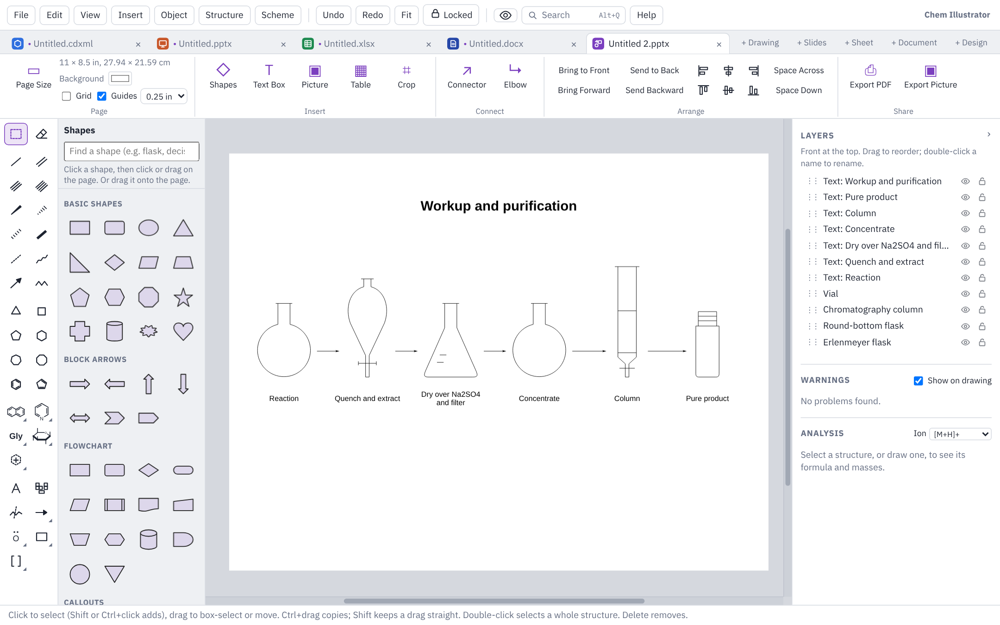

# Design

This page covers Design mode: single-page graphics such as TOC graphics, graphical abstracts, posters, flowcharts and workup schemes, and how to export them for a journal.

## Starting a design

Click **+ Design** at the end of the tab strip, or choose **File ▸ New Design…**. A gallery opens with a **Blank page** and six ready-made layouts.

A design is a single page. For several pages, use [Slides](slides.md) instead.

## Page sizes

Pick **Blank page** and choose a size. **Page Size** on the ribbon changes it later.

| Group | Sizes |
|---|---|
| Journal graphics | TOC graphic, ACS (3.25 × 1.75 in); Graphical abstract, Elsevier (13 × 5 cm); TOC graphic, Wiley (5.5 × 5 cm); Graphical abstract, RSC (8 × 4 cm); Journal figure, one column; Journal figure, two columns |
| Posters | 36 × 48 in portrait; 48 × 36 in landscape; A0 |
| Screens | Slide 16:9 |
| Paper | Letter; Letter, landscape; A4 |

You can also type a custom size in in, cm, mm, pt or px. Journals change their requirements from time to time, so check the size against your journal's author guidelines.

Structures are drawn larger on bigger pages so they stay readable: at their normal size on journal graphics and paper, twice as large on slides and four times as large on posters.

The ribbon's **Page** group also sets the **Background** colour, shows a **Grid** (on screen only, never saved or printed) with its spacing, and turns **Guides** on and off.

## Ready-made layouts

| Layout | What it gives you |
|---|---|
| **TOC graphic** | Starting material, arrow, product and a one-line message, at the ACS size |
| **Graphical abstract** | Three panels: the challenge, your approach and the outcome, at the Elsevier size |
| **Conference poster** | A title banner with room for logos, and three columns of sections (48 × 36 in) |
| **Flowchart** | A reaction run as steps, with a decision and a loop back, joined by connectors |
| **Workup scheme** | Glassware from reaction to pure product, with a label under each step |
| **Timeline** | A project as five milestones on a line |

Everything in a layout is ordinary shapes and text you can change. The dashed boxes show where your structures go.

## Shapes

The shape library on the left has five groups:

- **Basic shapes:** rectangle, rounded rectangle, oval, triangle, diamond, hexagon, star, cylinder, cloud and more.
- **Block arrows.**
- **Flowchart** shapes.
- **Callouts.**
- **Lab equipment:** round-bottom flask, Erlenmeyer flask, beaker, vial, test tube, separatory funnel, condenser, chromatography column, TLC plate, syringe, stirrer hot plate, bath and funnel.

Type in the search box at the top to find one (try "flask" or "decision"). **Shapes** on the ribbon takes you to the library.

To place a shape, click it and then click or drag on the page, or drag it straight from the library onto the page. Double-click a shape to type inside it; the chemistry typing helpers work there, so CH2Cl2 gets its subscripts. The **Style** panel on the right sets fill, outline, line width, transparency and where the text sits.

The ribbon's **Insert** group also adds a **Text Box**, a **Picture** or a **Table**, and **Crop** trims a picture.

### Structures

All the drawing tools and hotkeys work on a design page, so you can draw structures, reaction arrows and schemes straight onto it, or paste them from a drawing tab or ChemDraw (Windows app).

### Pictures with a white background

Insert a PNG or JPEG (a logo, say), select it, and click **Remove white…** in the **Style** panel. You can remove only the white joined to the edges, or all white, and set how near to white counts. Undo puts the white back.

## Connectors

**Connector** (a straight line) and **Elbow** (square bends) are in the ribbon's **Connect** group. Drag from one shape's blue dot to another's. When you move either shape, the connector follows. Drag a connector's end away from a dot to unstick it.

## Smart guides

As you drag a shape near another, pink lines show when edges or centres line up, and the shape snaps into line. Page edges count too. Hold **Alt** to drag freely, or untick **Guides** on the ribbon to turn them off.

## Arranging

The ribbon's **Arrange** group has **Bring to Front**, **Bring Forward**, **Send to Back** and **Send Backward**, buttons to line up left edges, centres, right edges, tops, middles and bottoms, and **Space Across** and **Space Down** to space things evenly.

## The Layers panel

The **Layers** panel on the right lists everything on the page, front first.

- Drag the ⋮⋮ grip to change the order.
- Click the eye to hide something, or the lock so clicks pass through it.
- Double-click a name to rename it.

## Saving and exporting

- **Save** (Ctrl+S) writes a one-slide PowerPoint file (.pptx). In PowerPoint the shapes look the same and connectors are PowerPoint connectors. Open it here again and everything is editable, with connectors still attached to their shapes.
- **Export Picture** (ribbon **Share** group, or **File ▸ Export Picture…**) saves a PNG at the resolution you type, or an SVG. Choose the page colour or a see-through background. Journals usually ask for 300 dpi for colour pictures and 600 to 1200 dpi for line art. A very large page at a very high dpi is reduced to what fits in memory, and a message says which dpi was used.
- **Export PDF** (ribbon **Share** group, or **File ▸ Export PDF…**) saves the page at its exact size.
- **File ▸ Print…** (Ctrl+P) prints the page at its own size.

Next: [Getting started](getting-started.md) · [Drawing](drawing.md) · [Keyboard and mouse](keyboard-and-mouse.md) · [Slides](slides.md) · [Documents](documents.md) · [Sheets](sheets.md) · [Files and sharing](files-and-sharing.md) · [Feedback](feedback.md)
