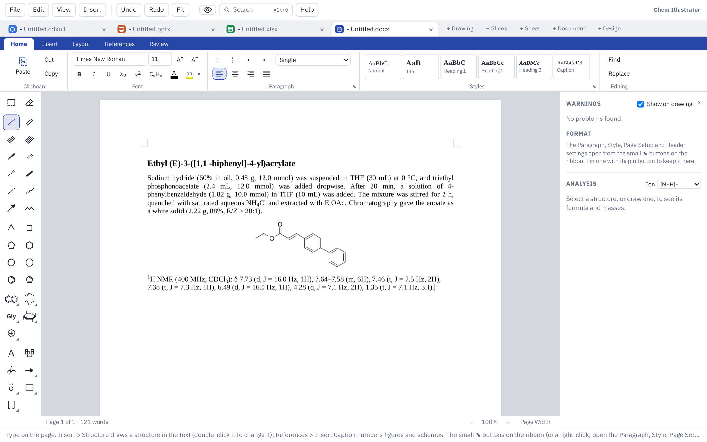

# Documents

This page covers Document mode: writing and formatting text, putting structures, tables and equations in it, captions, compound numbers, references, page layout, tracked changes, and saving as Word or PDF.

## Starting a document

Click **+ Document** at the end of the tab strip, or choose **File ▸ New Document**. While a document is showing, Ctrl+N starts another one.

The ribbon has Word's tabs: **Home**, **Insert**, **Layout**, **References** and **Review**, plus a **Table** tab that appears while the caret is in a table. Text flows on to the next page by itself. The status bar at the bottom shows the page and word count; Ctrl+mouse wheel or the − and + buttons zoom, and **Page Width** fits the page to the window.

## The chemistry toolbox

The drawing toolbox shows on the left in Document mode too. Pick a drawing tool there and the selected structure opens for editing with that tool; if no structure is selected, a new drawing starts at the caret. Press **Done** above the drawing to put it back in the text.

When the pointer turns into a pointing hand over a structure, it is a drawing you can open: double-click it (or pick it and use **Insert** tab ▸ **Edit Drawing**).

## Formatting text

- **Home** tab: font, size, colour, bold (Ctrl+B), italic (Ctrl+I), underline (Ctrl+U), subscript (Ctrl+=), superscript (Ctrl+Shift+=), bigger and smaller (Ctrl+] and Ctrl+[).
- **C₉H₈** sets the selection in formula style: numbers lowered, charges raised.
- **Highlight:** the **ab** button highlights the selected text; the arrow beside it picks the colour.
- The chemistry typing helpers work as in the other modes: type CH2Cl2 or CDCl3 and the numbers drop down once you type a space or punctuation after it.
- Misspelt words get a red line, and right-click offers corrections. Chemistry words are in the dictionary; add your own with right-click ▸ **Add to Dictionary**. **Edit ▸ Typing and Spelling…** has the settings.

## Paragraphs and lists

- Alignment: Ctrl+L, Ctrl+E, Ctrl+R and Ctrl+J, or the **Home** tab buttons.
- Line spacing: the **Home** tab list, or Ctrl+1 (single), Ctrl+5 (1.5) and Ctrl+2 (double). **Line Spacing Options…** offers **Exactly** or **At least** a number of points.
- Indents and space before and after: **Layout** tab ▸ **Paragraph** group. Lengths are in inches; type `cm`, `mm` or `pt` after a number to use those instead.
- **Bullets** and **Numbering** on the **Home** tab make lists. Tab and Shift+Tab change the level.
- The small ⬊ in the corner of a ribbon group opens all of that group's settings. Its pin button docks the box in the right-hand panel so it stays open while you work.

## Styles

The **Home** tab has **Normal**, **Title**, **Heading 1–3** and **Caption**. Shortcuts: Ctrl+Alt+1, 2 and 3 for headings, Ctrl+Shift+N for Normal.

To change a style, open the ⬊ in the corner of **Styles** (or the **Format** panel on the right). Change the font, size, bold, spacing and so on, and every paragraph in that style follows, apart from anything you formatted by hand.

- **Match This Paragraph** makes the style look like the paragraph the caret is in.
- **Reset Style** puts the style back as it first was.

## Structures and pictures in the text

- **Insert** tab ▸ **Structure** opens the drawing tools. Draw, press **Done**, and the structure sits in the text at the caret.
- **Insert** tab ▸ **From Name** draws a structure from a name or SMILES.
- Paste a structure copied from a drawing tab, or from ChemDraw (Windows app).
- **Insert** tab ▸ **Picture** adds a picture from a file; you can also paste or drop one.
- **Insert** tab ▸ **Shapes** puts a shape from the library (basic shapes, block arrows, flowchart shapes, callouts, lab glassware) in the text at the caret. It is a drawing like a structure: double-click it to change its size, colours or text with the drawing tools, and use the wrapping settings below to let text flow round it.

Click a structure or picture to pick it. Drag its corner handle, or type a **Size (%)** in the panel; **Own Size** puts it back to 100%. Right-click it for **Add Frame** and **Add Shadow**; the panel sets the frame's width and colour and a soft or sharp shadow.

### Wrapping and text boxes

Pick a structure, picture or text box, then use **Layout** tab ▸ **Wrap Text** (or the right-click menu):

| Choice | Effect |
|---|---|
| **In Line with Text** | Sits in the line, like a letter |
| **Square** | Text flows down the wider side |
| **Top and Bottom** | Text only above and below |
| **Behind Text** / **In Front of Text** | Floats over or under the text |

A floating item can be dragged anywhere and moves with the paragraph it is dropped beside. One in line with the text is dragged to another place in the text, as in Word: the caret shows where it will land (Ctrl+Z puts it back).

**Insert** tab ▸ **Text Box** (also on the **Layout** tab) puts a box at the left margin with the text wrapping round it. Type in it, then press Esc to pick the box. Drag its edge to move it and its corner to make it wider. Fill colour, frame and wrapping are in the panel.

## Tables

**Insert** tab ▸ **Table** asks for the number of rows and columns and a style:

- **Plain table** (grid lines, as in Word);
- **ACS table in the text** (rules above, under the headings and at the bottom);
- **No lines**;
- **ACS table as a drawing** (edited in the drawing tools, then placed as a figure).

The first three go straight into the text with the caret in the first cell. Type, press Tab for the next cell (Tab in the last cell adds a row) and Shift+Tab to go back. CH2Cl2 typed in a cell becomes a formula when you move on.

While you are in a table, the **Table** tab offers:

- **Insert Above**, **Below**, **Left**, **Right**; **Delete Row**, **Delete Column**, **Delete Table**;
- **Merge Right**, **Split Cell**, **Select Table**;
- **Lines** (grid, ACS rules or none) and **Heading rows**;
- **Shading** and **No Shading**;
- alignment **Across** (Left, Centre, Right, for the column) and **Down** (Top, Middle, Bottom, for the cell);
- **Column width**, **Fit to Contents**, **Fit to Page** and **Even Columns**.

The same commands are on the right-click menu. Esc picks the whole table, and Delete then removes it.

### Structures in table cells

For a substrate-scope or screening table, put the caret in a cell and use **Insert** tab ▸ **Structure**, **From Name** or **Picture**, or paste a structure. It goes into that cell, shrinks to fit the column if needed, and the row grows to hold it.

- Set the column to **Centre** to line the structures up.
- Set the other cells in the row to **Middle** so their text sits level with the structure.
- **Fit to Contents** widens the columns so structures show at full size.

## Charts

**Insert** ▸ **Chart** puts a chart in the text at the caret, as Word's Insert Chart does. The chart window shows the chart's own data in a grid: type over the sample numbers or paste from Excel or a sheet, pick the kind of chart along the top, and change titles, axes, colours, error bars and fitted lines in the panel on the right. Double-click the chart to change it again. Charts sit in the text like pictures (wrap, frame, captions), and are saved in Word files as Word charts with their data inside, so **Edit Data** works in Word. Charts made in Word open here as charts.

## Captions and cross-references

On the **References** tab:

- **Insert Caption** adds a numbered caption: Figure, Scheme, Table, Chart or Equation. Choose **S** under "Before the number" for Supporting Information numbering (Scheme S1).
- **Cross-reference** puts "Scheme S1" in the text.

Add, delete or move captions and every number and reference follows.

## Compound numbers

**References** tab ▸ **Compound Number** puts a bold compound number in the text. Choose **A new compound** for the next number, or pick one already numbered to mention it again. Numbers follow the order compounds are first mentioned, so adding one earlier in the text renumbers the rest. Type a letter after a number for a series (2a, 2b).

## References and bibliography

1. **References** tab ▸ **Manage References…** holds the document's references. Add them with **Add by DOI…** (looked up on Crossref; needs the internet), **Add by Hand…**, **Import BibTeX / RIS…** or **Paste BibTeX / RIS…**. **Edit…** and **Delete…** change them.
2. Put the caret where a citation belongs and click **Insert Citation**. Citations are numbered in order of first citation.
3. Click **Bibliography** to add a References heading and the numbered list.

### Citation styles

Pick the **Citation style** in **Manage References…**. Every citation and the bibliography change at once, and Ctrl+Z undoes it.

| Style | Used by, for example |
|---|---|
| ACS | J. Am. Chem. Soc., J. Org. Chem., Org. Lett. |
| RSC | Chem. Sci., Chem. Commun., Org. Biomol. Chem. |
| Wiley-VCH (Angewandte) | Angew. Chem., Chem. Eur. J. |
| Chemistry Europe | Eur. J. Org. Chem., ChemBioChem |
| Elsevier | Tetrahedron, Bioorg. Med. Chem. |
| Nature | Nature, Nat. Chem., Nat. Commun. |
| Science | Science, Sci. Adv. |
| Thieme | Synthesis, Synlett |
| Beilstein | Beilstein J. Org. Chem. |
| MDPI | Molecules, Catalysts |

**Style Options…** opens every detail of the style, with a preview: how citation numbers look, whether 1,2,3 becomes 1–3, how the list is numbered, how author names are written and when "et al." is used, the journal title, year, volume, pages and DOI. A changed detail is marked with a dot, and **Reset to …** puts the style's own details back. Tick **Use for new documents** to start every new document with your choice.

Journal requirements change, so check the result against a recent issue of your target journal.

## Pages, columns, headers and footers

On the **Layout** tab:

- **Margins**, **Paper** (Letter, A4 or your own size), **Orientation**.
- **Page Break** (Ctrl+Enter).
- **Columns**: One, Two, Three or Four; **More Columns…** sets the gap. **Column Break** (Ctrl+Shift+Enter) starts the next column.
- **Page numbers**: top or bottom, left, centre or right. **S1, S2… numbering** numbers the pages as Supporting Information is numbered.
- **Header…** and **Footer…** set the text at the top and bottom of every page. The ⬊ in the corner of the group sets where they sit, the first page number and whether the first page is numbered.

## Table of contents

Give your headings **Heading 1**, **2** or **3**, put the caret where the contents should go, and choose **References** tab ▸ **Table of Contents** (also **Insert ▸ Table of Contents…**). Pick how many heading levels to show.

The contents keep themselves up to date: page numbers change as text moves, and renamed headings change as you type. There is no Update button. Double-click the contents to change the number of levels. With S1, S2 page numbering, the contents use the same numbers.

## Tracked changes

1. **Review** tab ▸ **Track Changes** (Ctrl+Shift+E). The first time, it asks for the name to put on your changes; change it later with **Your Name…** or in **Edit ▸ Preferences…**.
2. Text you type is underlined in your colour; text you delete stays, struck through.
3. **◀ Previous** and **Next ▶** step through the changes; the bar at the bottom says who made each one and when.
4. **Accept** or **Reject** decides the change at the caret (or every change in a selection) and moves to the next. **Accept All** and **Reject All** do the whole document. Right-click a change for Accept and Reject too.

Changes made by other people in Word open here as changes, in a different colour for each person.

## Comments

1. Select some words (or just click in a word) and choose **Review** tab ▸ **New Comment** (Ctrl+Alt+M, or right-click ▸ **New Comment**). The first time, it asks for the name to put on your comments.
2. Type the comment in the card that opens beside the page and press Enter (Shift+Enter starts a new line). Escape on an empty card takes it away again.
3. The words a comment is on are shaded. Click in them, or click the card, to see that comment; the cards line up beside their words.

On a card:

- **Reply** adds an answer under the comment, with your name and the time.
- **Resolve** marks it as dealt with: it stays, greyed, until you delete it. **Reopen** brings it back.
- **Edit** changes the text, and **Delete** removes the comment with its replies. Replies have their own Edit and Delete.

The Review tab also has **◀ Previous** and **Next ▶** to step through the comments, **Delete All**, and **Show Comments** to hide or show the cards. Undo works for every change. If you delete all the words a comment is on, the comment goes with them (and comes back with Undo).

Comments are saved in the .docx as Word's own, with their replies and Resolved marks, so they show in Word's comment pane; comments added in Word open here the same way.

## Equations

**Insert** tab ▸ **Equation** (or **Insert ▸ Equation…**, or Alt+=) opens the equation window.

- Type LaTeX in the box, for example `\Delta G = \Delta H - T\Delta S`. The preview updates as you type.
- Or use the buttons above the box (fraction, scripts, root, brackets, sum, integral, arrow with conditions, Greek letters and signs). Select text first and the piece goes round it.
- Or pick a common one from **Start from**: Gibbs, Arrhenius, Eyring, Beer–Lambert, ee, Henderson–Hasselbalch and others.
- **On a line of its own, centred** is ticked for you on an empty line. Untick it to put the equation in the line of text.

Letters are set in italic as variables. Use `\mathrm{…}` for element symbols, `\text{…}` for words and units, and `{-}` for a dash that is a bond rather than a minus sign. Double-click an equation (or right-click ▸ **Edit Equation…**) to change it.

## Find and replace

**Home** tab ▸ **Find** (Ctrl+F) opens a box at the top right of the pages. Every match is lit up; Enter and Shift+Enter step through them, and **Match case** and **Whole words** narrow the search. **Replace** (Ctrl+H) adds the replace part, with **Replace** for one at a time and **All** for every match.

The **Make it** buttons change how the replacement looks: formula, bold, italic, underline, subscript, superscript, or plain. Leave "Replace with" empty to change only the look: for example, find `CH2Cl2`, choose the formula look, then **All**, and every CH2Cl2 in the text becomes CH₂Cl₂. Each Replace All is one step to undo. Finding goes by the letters alone, so CH2Cl2 is found however it is formatted.

## Saving as Word and PDF

- **Save** (Ctrl+S) writes a Word file (.docx). In Word, styles are Word's own, lists are Word lists, and captions, cross-references, compound numbers, page numbers and the table of contents are Word fields. Tracked changes and equations are Word's own too, so they keep working there.
- Structures show as pictures in Word. Open the file here again and they are editable drawings, even after Word has saved it.
- The free fonts that come with the app are saved inside the file when you use them.
- Opening a Word file made in Word brings in its text, styles, lists, tables, pictures, captions and cross-references. ChemDraw drawings embedded in it become editable structures. Anything left out is listed in a note.
- **File ▸ Export PDF…** saves the pages exactly as they look on screen, with sharp structures, text and equations.
- **File ▸ Print…** (Ctrl+P) prints every page as laid out.

Next: [Getting started](getting-started.md) · [Drawing](drawing.md) · [Keyboard and mouse](keyboard-and-mouse.md) · [Slides](slides.md) · [Sheets](sheets.md) · [Design](design.md) · [Files and sharing](files-and-sharing.md) · [Feedback](feedback.md)
