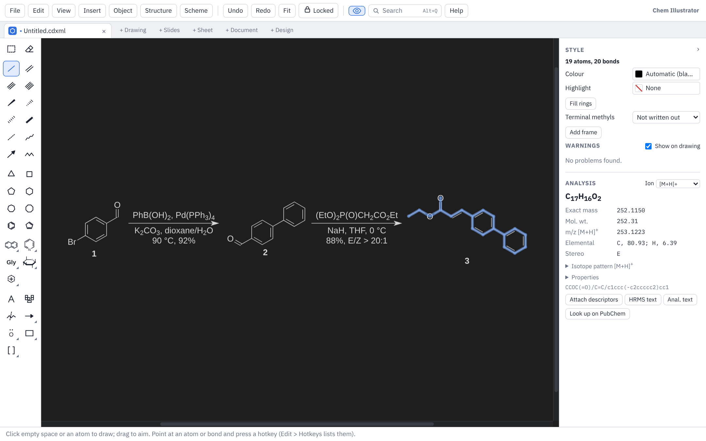

# Drawing

This page covers Drawing mode in depth: the tools, hotkeys on atoms and bonds, text, arrows and shapes, the Chemistry and Format menus, drawing styles, the dark page, the Analysis panel and the other chemistry tools.

If you use ChemDraw, most of this will feel familiar: the hotkeys are ChemDraw's, new drawings use the ACS Document 1996 style, and files are saved as `.cdxml` or `.cdx`. Mac users: read Cmd for Ctrl and Option for Alt.

## The toolbox

The drawing tools run down the left side, in groups. A button with a small arrow in its corner holds a set of tools; click the corner, click the button again once it is in use, right-click it, or press and hold it to open the set. The button then shows the tool you used last. Text, arrows and the mechanism symbols sit just under the bonds so they show without scrolling; on a short window the tools take three columns, and the toolbox fades at the bottom while there is more below. Rest the mouse on any tool to see its name and hotkey, and watch the hint line at the bottom of the window for how to use it.

### Select and eraser

- **Select and move**: click to select, drag a box round things to select them, drag a selection to move it. Double-click an atom or bond to select its whole structure. Delete removes the selection.
- **Eraser**: click an atom, bond, caption, arrow or shape to remove it.

### Bonds and chains

Single, double and triple bonds (a quadruple bond has its hotkey and Search, off the toolbox); wedge, hashed wedge, hashed, bold, dashed and wavy bonds; a partial bond; a dative bond; a hapto (η) bond; and the chain tool.

- Click empty space or an atom to draw a bond; drag to aim it. New bonds point in 15° steps and are a standard length. Hold Alt while drawing to draw at any angle, or turn off **Chemistry ▸ Fixed Bond Lengths** (Ctrl+L) and **Fixed Angles** (Ctrl+E).
- Click an existing bond with the single bond tool to step it through single, double and triple. Click a double bond again with the double bond tool to move its second line. Click a wedge or dative bond again to reverse it.
- Draw a dative bond from the donor atom to the acceptor (H3N→BF3). Neither atom loses a hydrogen for it.
- **Partial bond**: a bond forming or breaking in a transition state, drawn dashed (press `P` over any bond to make it one). Like a dative bond it leaves both atoms' hydrogens as they were, it gets no valence warning, and the formula and SMILES leave it out. It saves to CDXML as a half bond (Order 0.5). **Chemistry ▸ Reactions and Schemes ▸ Transition State Brackets ‡** then puts square brackets round the selected transition state with ‡ at the upper right.
- **Hapto (η) bond**: drag from a metal into a ring, or onto a C=C, to bond the metal to its middle (η⁵-Cp, η⁶-arene, η³-allyl, η²-alkene; the η number is how many atoms it holds). Drag the other way, from the ring to empty space, for a new metal M. Click inside a ring or on a bond for a new metal there. The bond stays in the middle when you move or reshape the ring. Click a hapto bond to draw it as a line to each atom instead (some draw ferrocene that way). In ChemDraw the bond opens as a multicentre attachment.
- **Chain**: drag from empty space or an atom; a number shows how many bonds you have. Or click and type how many atoms you want. Alt+click draws the same number again.

### Rings

Cyclopropane to cyclooctane, benzene and cyclopentadiene.

- Click empty space to place a ring, a bond to fuse it on, or an atom to make a spiro ring. Alt+click an atom to attach the ring by a new bond instead. Drag to turn it.
- With benzene, Shift+click swaps the double bonds round; Ctrl+click draws it with a circle inside. Ctrl+click with cyclopentadiene also draws a circle.

### Templates

Ready-made structures in palettes on the tool bar, plus **My templates**:

- **Ring systems**, **Heterocycles**, **Amino acids** and **Sugars** (pyranoses and furanoses flat and as ⁴C₁ chairs).
- **Conformers**: cyclohexane chair (both ring flips), boat, twist-boat, half-chair and cyclohexanone; the cyclopentane envelope and half-chair, cyclopentene, puckered cyclobutane; the cycloheptane twist-chair, cyclooctane boat-chair and crown, and the cyclooctatetraene tub. The "with its bonds" versions show every axial and equatorial bond.
- **Fused and caged rings in 3-D**: trans- and cis-decalin and hydrindane, diquinane, hydroazulene, perhydrophenanthrene and perhydroanthracene, the 5α and 5β steroid skeletons, adamantane, twistane and cubane.
- **Bicyclic rings**: bicyclo[1.1.0]butane up to bicyclo[4.4.1]undecane, drawn in 3-D.
- **Projections and stereocentres**: Newman, sawhorse and Fischer projections; tetrahedral centres drawn several ways; trigonal bipyramidal, octahedral, square pyramidal and square planar centres; zig-zag chains with wedges.
- **Large rings**: 9- to 20-membered rings, as polygons and folded.
- **Aromatics**: from the cyclopropenylium ion to coronene and porphine, plus corannulene, triptycene and C₆₀.
- **Rings in perspective**: 3- to 6-membered rings seen at an angle, with and without bold front bonds.
- **Metal complexes**: coordination geometries round a metal M (linear to octahedral, with wedges for the bonds towards you), η³-allyl and η²-alkene complexes, a chloride-bridged dimer, an M≣M quadruple bond and a β-agostic alkyl.
- **Metallocenes and half-sandwich complexes**: ferrocene staggered and eclipsed, Cp₂M both ways, decamethylferrocene, ferrocenium, cobaltocenium, bis(benzene)chromium and uranocene; a ferrocenyl group (click an atom and it joins it by a bond, kept upright and flipped to face the way the bond goes), 1,1′- and 1,2-disubstituted ferrocenes; bent metallocenes (Cp₂MX₂, Cp₂TiCl₂, Cp₂ZrCl₂, the Schwartz, Petasis and Tebbe reagents, Cp₂TiCl, Cp*₂MX₂); ansa-metallocenes with an SiMe₂ or CH₂CH₂ bridge, rac-(EBI)ZrCl₂ and the constrained-geometry catalyst; piano stools CpML₃, Cp*ML₃, (η⁶-arene)ML₃, CpML₂, (benzene)Cr(CO)₃, CpMn(CO)₃ and Fp–R; and the [Cp*RhCl₂]₂ and [(p-cymene)RuCl₂]₂ dimers. They are built from the real shapes (ring tilts and metal–ring distances from crystal structures) and drawn the textbook way, the rings seen from a little above, with a hapto bond from the metal to each ring's middle, so the Analysis panel's electron count works on them (Cp₂ZrCl₂ is Zr(IV), d⁰, 16 electrons).
- **Ligands**: PPh₃, PCy₃, P(t-Bu)₃, XPhos, SPhos, dppe, dppp, dppf, BINAP, Xantphos, IMes, IPr, CO, MeCN, pyridine, bipy, phen, TMEDA, en, acac, Cp, Cp*, benzene, p-cymene, indenyl, allyl, ethylene and COD. Click a metal and the ligand goes on it, on its most open side; a chelate's donors both bond to it.

The conformers are drawn from real 3-D models (MMFF94 geometries), so their bond angles and ring shapes are true to life.

- Click empty space to place a template (drag while placing to turn it).
- Click a bond to fuse it on: pyridine on a benzene bond gives quinoline.
- Click an atom to join it there. Hold Alt to join it the other way (by a new bond, or sharing the atom).

#### Fusing conformers

When you fuse a conformer onto a ring that is itself drawn in 3-D (a chair, envelope, half-chair, decalin and so on), Chem Illustrator works out the ways the two rings can really share the bond and offers only those. A chair on a chair, for example, can join trans (both new bonds equatorial, as in trans-decalin) or cis (one axial, one equatorial, either way round).

- **Press and hold** on the bond: the blue outline shows the best way (trans first, then cis), with its name beside it ("trans-fused · 1 of 3").
- **Move the pointer** towards where you want the new ring: the outline swaps to the fusion lying nearest the pointer.
- **Tab** and **Shift+Tab**, with the mouse still held, step through the ways one at a time.
- **Release** to place it.
- Or **right-click the bond** and pick **Fuse a Ring Here**: each conformer that fits, and the ways it can join (Trans-fused, Cis-fused 1, Cis-fused 2).
- The `9` and `0` keys on a bond of a chair fuse another chair trans and cis.

This is enough to build decalins, hydrindanes, steroids (5α and 5β), triterpenes such as oleanane, and the hydroazulenes of the guaianes ring by ring.

#### Metal complexes

Metals know they are metals: a metal gets no hydrogens and no valence warning however many ligands it holds, and a phosphine, amine, pyridine, bridging chloride or carbonyl on a metal keeps the hydrogens and charges it had (PPh₃ stays P, not PH; M–C≡O needs no charges). Ligand labels work too: type PPh3, dppe, BINAP, XPhos, bpy, IMes, Cp*, COD, acac, THF and so on as labels on a metal. The formula and masses in the Analysis panel count them all, ferrocene included.

- Right-click a metal: **Add Ligand** puts a ligand from the list on it.
- **Chemistry ▸ Metals ▸ Bond Metal to Ring (η)**: select a metal and the ring or π-bond atoms; their bonds become one hapto bond to the middle. **Split Hapto Bond** goes back to a bond to each atom.
- **Chemistry ▸ Expand Label**: draws a label out as atoms. A ligand on a metal comes from its template (dppe gives both P atoms bonded to the metal); other abbreviations (OMe, Boc, CO₂Et) are laid out along the bond they hung from.

To make your own template, select a structure and click the first button on the **My templates** palette, or use **Chemistry ▸ Nicknames and Templates ▸ Save as Template…**. Give it a name and it appears in the palette. **Chemistry ▸ Nicknames and Templates ▸ Delete Template…** removes one.

### Text, periodic table and fragmentation

- **Text**: click an atom to type a label, or empty space for a caption. See [Text and captions](#text-and-captions).
- **Periodic table**: pick an element, then click atoms to change them, or empty space to add a lone atom. Atoms already selected change at once. You can type a symbol in its box and press Enter. Open it from **Chemistry ▸ Look Up ▸ Periodic Table…** or Search (it is no longer a toolbox button).
- **Mass fragmentation**: see [Mass fragmentation](#mass-fragmentation).

### Arrows, mechanism symbols, shapes and brackets

- **Arrows**: reaction, dashed, hollow-headed, resonance (heads at both ends), equilibrium, retrosynthetic and crossed-out (reaction does not go). Drag to draw one, or click for a standard length. Drag an end to move it and drag the middle to bend the arrow into an arc. With the arrow tool, Shift+drag from an arrow's end or middle to branch a second arrow off it (one starting material, two products).
- **Curved arrows** (electron pair) and **fishhook arrows** (one electron): drag from a lone pair, radical dot, circled charge, atom or bond to an atom or bond, and the arrow snaps into place as in a mechanism. If you have drawn lone pairs on the atom, the arrow starts from the one facing where it goes. A bond's arrow starts from the middle of the bond. Let go between two atoms that are not bonded (the C and C that will join in an aldol or Diels–Alder) and the head points at the new bond's place. The arrow picks the side and curl that keep it clear of the other atoms and bonds, and switches to an S shape when no single bend gets round the structure; swing out to one side as you drag to bend it that way instead. Drag the middle dot to change the curve. Hold Alt to draw freely.
- **S-shaped arrows**: the **S-shaped curved arrow** and **S-shaped fishhook** tools (in the curved arrow set) always draw two bends, for an arrow that has to go round something or come in from behind. Drag the two diamond handles to shape it. **Chemistry ▸ Mechanism Arrows ▸ Make S-Shaped Arrow** turns a selected curved arrow into an S, and **Chemistry ▸ Mechanism Arrows ▸ Make Single-Curve Arrow** turns it back. **Chemistry ▸ Mechanism Arrows ▸ Flip Arrow Bend** bends a curved arrow the other way round, half head and all.
- **Arrows stay on the structure:** a curved arrow drawn onto a lone pair, atom, bond or new bond's place is stuck there. Move, turn, flip or clean up the structure and the arrow goes with it, stretching if the atoms move apart; undo puts both back. Lone pairs, radical dots and circled charges stay on their atoms the same way. Drag an arrow's end a little and it stays stuck at the new place; drag it right off and it comes loose. **Chemistry ▸ Mechanism Arrows ▸ Detach from Structure** (or **Unstick from structure** in the Style panel) frees a selected arrow, and **Chemistry ▸ Mechanism Arrows ▸ Attach Arrows to Structure** sticks it to whatever its ends are on.
- **Homolysis**: select one or more bonds and choose **Chemistry ▸ Mechanism Arrows ▸ Homolysis Arrows** (or right-click the bond) for the two fishhooks that split each bond, one to each atom, on the open side.
- **Moving an arrow's end:** drag the end of a curved arrow onto a lone pair, atom or bond and it snaps there, keeping the side it bends to. Hold Alt to put the end anywhere.
- **Clean Up Arrow** (**Chemistry ▸ Mechanism Arrows ▸ Clean Up Arrow**, or right-click a curved arrow): redraws the selected curved arrows from the lone pair, bond or atom their tail is on to what their head points at, starting and ending at a sensible angle and clear of the structure. S-shaped arrows stay S-shaped. Undo puts them back. It has no key to start with; give it one in **Edit ▸ Hotkeys…**. Right-click a curved arrow for the **Mechanism Arrow** menu with all of these.
- **Files:** S-shaped arrows are saved in .cdxml and .cdx as ChemDraw curves with arrowheads, so ChemDraw shows them. What an arrow is stuck to is saved too, for Chem Illustrator; ChemDraw ignores it.
- **Mechanism symbols**: lone pair, radical dot, circled plus and minus, δ+ and δ−, and ‡ (click where it goes). Click an atom and the symbol goes in the most open space round it. To put a lone pair (or radical dot or circled charge) somewhere else, press on the atom and drag: the symbol goes round the atom after the pointer, and lands where you let go. Hold Alt (or Shift) while dragging to turn it in 15° steps, as when turning a structure. A radical dot makes the atom a radical (one H fewer); a circled charge sets the atom's charge.
- **Charges by labels** sit raised after the label (N⁺). A bond that runs under the sign stops short of it, as in ChemDraw; if that would leave almost nothing of a short bond, the charge moves to a free spot round the label instead.
- **Shapes**: boxes (plain, round-cornered, with a shadow, dashed), ovals, circles drawn from the centre, a filled circle, and plain, dashed and bold lines. Drag to draw; Shift while drawing an oval makes a circle. Drag the corner squares to resize.
- **Brackets**: square, round and curly, transition-state brackets (square, with ‡ at the upper right), and a single left or right bracket. Drag a box to put brackets round it, or click a structure to bracket it.

Select any arrow, shape or bracket to change its line width, colour, dashes, fill, corners and shadow in the **Style** panel.

## Hotkeys on atoms and bonds

As in ChemDraw, point at an atom or bond (it highlights blue) and press a key. Some favourites:

- On an atom: `1` adds a bond, `2` a C=O, `6` cyclohexyl, `a` phenyl, `o` makes it O, Shift+O makes it OMe, `+` and `-` charge it.
- On a bond: `2` makes it double, `w` a wedge, `h` a hashed wedge, `a` fuses benzene, `6` fuses cyclohexane, `9` and `0` fuse a chair.

A key that grows something moves the highlight to the new atom, so you can keep typing: `8` then `1` gives an E double bond. Pressing `1` or `0` with the mouse on an atom keeps the highlight there, so `1` three times adds three bonds to it.

[Keyboard and mouse](keyboard-and-mouse.md) has the complete lists. **Edit ▸ Hotkeys…** shows every key and lets you change any of them.

## Text and captions

Pick the text tool (`t` over empty space) and:

- **click an atom** to type a label such as OMe, CO2Et or NHBoc;
- **click empty space** for a one-line caption;
- **drag across empty space** to make a text box that wraps its lines. Drag the small handle on its right side to make it wider or narrower.

Double-click a caption to edit it again. Press Esc to finish.

While you type, a bar along the top of the drawing has bold, italic and underline, subscript and superscript, **formula style**, font, size and colour, alignment, bullets and numbering, indents, line and paragraph spacing, and a set of Greek letters and symbols (**αΩ**). It sits along the top so it never covers what you have drawn; **View ▸ Text Formatting Bar** can float it just above the text instead, or hide it (the keys below still work).

Useful keys while typing:

| Key | Does |
|---|---|
| Ctrl+B, Ctrl+I, Ctrl+U | Bold, italic, underline |
| Ctrl+= or F9 | Subscript |
| Ctrl+Shift+= or F10 | Superscript |
| Ctrl+F | Formula style |
| Tab, Shift+Tab | Change the level of a list item |
| Ctrl+Shift+V | Paste as plain text |

Formula style writes CH3CO2H with its numbers lowered and raises a + at the end of a word (NH4+). To raise a minus charge or a charge with a number (Fe3+), select it and use superscript, as in ChemDraw.

As you type, common chemistry is tidied for you: CH2Cl2 gets its subscripts, `0 oC` becomes 0 °C, `1H NMR` gets its superscript. Press Ctrl+Z straight away to undo just that change. Misspelt words get a red underline and formatting slips (a hyphen in a range, a number run into its unit) a blue one; right-click for suggestions. **Edit ▸ Typing and Spelling…** turns these helpers off, adds your own replacements (`rxn` → reaction) and edits your dictionary.

You can paste formatted text from Word into a text box; bold, italic, subscripts, colours and lists come across.

### Linking text to a structure

Select a caption and a structure and choose **Format ▸ Link Text to Structure** (also on the right-click menu). The text then moves, turns and copies with its structure. With only text selected, it links to the nearest structure. While either one is selected, a dotted grey line shows the link. **Format ▸ Unlink Text** lets it go again. **Edit ▸ Preferences** chooses where linked text goes: where it already is, or below, above, left or right of the structure.

### Turning text

Select a caption or text box on its own with the select tool, and a round handle appears above it. Drag the handle to turn the text; hold Shift or Alt to turn in 15° steps. When you turn a structure that has captions with it, the captions move round with the structure but stay upright. Labels attached to a structure (ID labels, descriptors) also stay upright.

## Moving, turning and the Format menu

Select something and:

- drag it to move it (with any tool: the pointer turns into a hand over a selection);
- drag the round handle above the selection to turn it;
- use the arrow keys to nudge it 1 pt, or Shift+arrow for 10 pt;
- press Alt+← or Alt+→ to turn it 1°, Alt+↑ or Alt+↓ for 15°.

The **Format** menu has:

- **Align Left Edges**, **Align Centres Across**, **Align Right Edges**, **Align Top Edges**, **Align Middles Down**, **Align Bottom Edges**;
- **Space Evenly Across** and **Space Evenly Down** (three or more things);
- **Flip Left to Right** (Ctrl+Shift+H), **Flip Top to Bottom** (Ctrl+Shift+V);
- **Rotate 90° Clockwise**, **Rotate 90° Anticlockwise**, **Rotate 180°** and **Rotate…** (Ctrl+R, any angle);
- **Scale…** (Ctrl+K): by a percentage, or to a bond length in points;
- **Join** (Ctrl+J): joins two selected atoms, or two selected bonds, into one;
- **Group** (Ctrl+G) and **Ungroup** (Ctrl+Shift+G): grouped structures, text, arrows and shapes select and move as one. Clicking any part selects the whole group, and a grey dashed box shows it; **Edit ▸ Preferences** can make a click pick just the one thing instead. Groups are kept in CDXML files, so ChemDraw opens them as groups too;
- **Bring to Front** and **Send to Back** for shapes and pictures;
- **Bring Bond to Front** and **Send Bond to Back**: where two bonds cross, the one behind gets a small gap.

**View ▸ Alignment Guides** makes things you move snap into line with other structures, text, arrows, shapes and the page edges, with pink guide lines. It starts off in drawings. Hold Alt while dragging to move freely.

Undo (Ctrl+Z) and Redo (Ctrl+Y) select what they changed, so you can see what came back and move it straight away.

To start a reaction quickly, select a structure and press Ctrl+→ (or Ctrl+←, Ctrl+↑, Ctrl+↓): you get a reaction arrow and a copy of the structure to edit into the product.

## The Chemistry menu

### Tidying and checking

- **Clean Up Structure** (Ctrl+Shift+K): evens out bond lengths and angles of the selected structures (or all of them) while keeping their shape, stereocentres and cis/trans double bonds. Undo puts it back.
- **Check Structure (next warning)**: goes to the next problem; see [Warnings](#warnings).
- **Aromatic Rings: Circle or Double Bonds** (Alt+K): switches selected rings (or all) between a circle and alternating double bonds.
- **H Atoms: Hide or Draw**: hides hydrogens that add nothing (not ones on wedges, charged ones, or ones on N or O); with nothing to hide, it draws the selected atoms' hydrogens.
- **Show Terminal Methyls (or Hide)**: writes chain ends out as CH3 or Me, or takes them away again. Choose Me or CH3 in **Edit ▸ Preferences**. With one structure selected, the Style panel's **Terminal methyls** box sets it for that structure.

### Labels and groups

- **Contract Label…**: turns a selected group into one label (such as PMP) that keeps its chemistry. ChemDraw opens it as a contracted label.
- **Expand Label**: the other way round: the selected labels drawn out as atoms and bonds (ligands on a metal from their templates). See [Metal complexes](#metal-complexes).
- **Define Nickname…**: select a group that hangs off a structure by one bond and give it a name. Typing that name as a label anywhere then counts as the full group for formula and mass. **Delete Nickname…** removes one.
- **Name to Structure…** (Ctrl+Shift+N): type a systematic, CAS-style or common name and the structure is drawn. Select a caption holding a name first to turn the caption into the structure. Names are read on your computer, so this works offline; names it can't read (DMAP, DIPEA) can be looked up on PubChem if you allow it in **Edit ▸ Preferences**.

### Frames, highlights and fills

- **Add Frame**: draws a box round the selection that grows, shrinks and moves with what is inside. Click the frame to set the gap across and up and down in the Style panel, untick **Fit round its contents** to stop it following, or click **Fit now**. Dragging a corner by hand also stops it following.
- **Highlight**: a soft band of colour (yellow to start) behind the selected atoms and bonds. With highlighted atoms selected, the Style panel sets the colour, **Highlight shape** (round or straight), **Smooth outline** (round) or **Highlight ends** (straight), **Centre on double bonds**, **Highlight size (%)**, **Grow round atom labels**, a shadow and soft edges. **Remove Highlight** takes it off.
  - Round highlights put a disc on each atom unless **Smooth outline** is on (or **Chemistry > Highlight and Fill > Smooth Highlight**, also on the right-click menu), which makes them one even band with round corners. Straight highlights are one even band with sharp corners where bonds meet, round, square or pointed ends, and a disc round each atom label. An atom with no highlighted bond gets a disc. Files with the older square or diamond highlights open as straight ones with square or pointed ends.
  - **Centre on double bonds** (or **Chemistry > Highlight and Fill > Centre Highlight on Double Bonds**) runs the highlight midway between a double bond's two lines. A ring drawn with its double bonds inside is highlighted midway between the ring and those inner lines, all the way round, so the highlight doesn't have to be made huge to cover both lines. Single bonds between double bonds (a chain such as a hexatriene) keep the highlight on their own line, so its corners follow the bonds' angles.
  - The Style panel keeps the everyday settings (colour, **Look**, shape, smoothing, size) at the top and the rest in groups that fold open: **Placement**, **Fill and texture**, **Outline**, **Soft edges**, **Shadow** and **Glow**. Each closed group shows what it is set to.
  - **Soft edges**: **How much fades (%)** sets how much of the highlight fades (25 % fades a quarter of it), and **Fades** picks where: the outer part, the inner part (next to the bonds), or half at each side.
  - **Fill and texture**: **Transparency**; one colour, a **Gradient across** (two colours at an angle), a **Gradient out from the bonds**, or no fill; and a **Texture** (lines, cross-hatch, grid or dots) with its own colour and spacing.
  - **Outline**: a solid, dashed or dotted line round the highlight, with its colour and width. **Outline Only** (Chemistry ▸ Highlight and Fill, right-click or the Highlight toolbox) switches between an outline with no fill and a filled highlight.
  - **Shadow**: colour, opacity, direction, distance and blur. **Glow**: a soft halo round the highlight, with its colour, size and transparency.
  - **Looks**: **Look** picks a ready-made look (Classic, Soft marker, Hollow, Neon, Lifted, Gradient across and more) or one of your own. **Save look…** keeps the selected highlight's settings under a name, with or without its colour; **Chemistry > Highlight and Fill > Delete Highlight Look…** removes one. Your looks are kept with your settings.
- **Fill Rings**: colours in the selected rings. The fills move with the structure. In the Style panel, a fill can be solid, faded, shaded or a two-colour **Gradient**, and can have a **Pattern** (diagonal lines, cross-hatch, horizontal or vertical lines, grid, dots), with its own colour and spacing. **Pattern see-through** lets what is behind show through the lines or dots, and **Pattern under double bonds** decides whether the pattern runs under the inner line of a double bond. The **Shadow** group gives a filled ring a drop shadow (with or without a highlight), with its colour, opacity, direction, distance and blur (design shapes have the same group); right-click a structure and choose **Highlight and Fill > Ring Fill Shadow** to turn it on or off. Copies of a structure (Ctrl+drag, or copy and paste) keep their ring fills. Boxes and ovals take the same fills and patterns.

### Labelling a structure

- **Add ID Label**: puts the next compound number under the structure, ready to type over.
- **Add Caption**: an empty caption under the structure, ready to type.
- **Attach Descriptors (Formula, Mass)**: the formula and masses under the structure. They follow it when you move it and update when you change it. Select them to choose the side and gap, which values are shown (formula, exact mass, MW, m/z, elemental analysis, HRMS) and the ion, or untick **Update when the structure changes** to keep text you typed yourself.

These follow the structure when it moves. Several stack up: ID label first, then caption, then descriptors.

### Stereochemistry

R/S and E/Z are worked out for every structure as you draw.

- **View ▸ Show R/S Preview** shows every label in red, on screen only.
- **Chemistry ▸ Stereo ▸ Show Stereo Labels (R/S, E/Z)** adds them to the selected structures (or all) as part of the drawing; they update themselves after edits. Select a stereocentre to hide its label or type your own, such as (R*).
- Plain bold bonds count as wedges and plain hashed bonds as hashed wedges, as in ChemDraw. Where R or S would depend on what an R or Ar group is, no label is given.
- **Axial chirality** (biaryls, allenes, alkylidenecycloalkanes) is labelled Ra or Sa by IUPAC rule P-93.5.1. Draw the groups on one end of the axis with a wedge and a hash (or one wedge) to show which way round it is. Without that, or when one end has two of the same group, no label is shown. **Edit ▸ Preferences** writes them as P/M instead (Ra = M, Sa = P).
- **Stereo Group (abs, &, or)…**: marks selected stereocentres as abs (known as drawn), &1 (a mixture of both forms) or or1 (one form, not known which).
- **Chiral Flag (Abs, Rel, Rac)…**: puts the boxed flag under the selected structure, or removes it.

### Polymers and R-groups

- **Polymer or Repeat Brackets (n, ×3)…**: put square brackets round a repeat unit with the bracket tool, select both brackets, and type `n` for a polymer or a number for a group repeated that many times. The Analysis panel then shows the formula as end groups plus the repeat unit.
- **R-Group Table…**: draw a core with R1, R2 (or R, X, Ar) as labels, select it and choose this. Type one compound per line, its groups separated by commas (`Me, H`), or paste cells from Excel. You can set a compound number (2 gives 2a, 2b, 2c…), choose whether formula and MW are worked out, and add columns to fill in yourself (`Yield (%), ee (%)`). The table goes under the structure; double-click a cell to change it.

### PubChem

**Chemistry ▸ Look Up ▸ Look Up on PubChem** (also in the Analysis panel and the right-click menu) sends the selected structure to PubChem and shows its names, CAS number, a link to its PubChem page, GHS hazards, and measured melting point, boiling point and density where known. See [The Analysis panel](#the-analysis-panel).

## Reactions and schemes

- **Clean Up Reaction** (Ctrl+Shift+R): lines up the structures on the arrow, centres the reagents over and under it, and spaces everything evenly.
- **Arrange Scheme…**: lays out a multi-step scheme. Click the layouts to try each one: **Line**, **Rows**, **Snake**, **Down the page**, **Catalytic cycle** (select a caption such as the catalyst's name too, and it goes in the middle) and **Branching**. **Done** keeps it; **Cancel** puts it back.
- **Number Compounds…**: puts numbers under the structures in scheme order. Choose 1, 2, 3; 1a, 1b; a, b; A, B; i, ii or I, II; where to start; text before and after (S for S1, S2); bold; whether copies of one structure share a number (**Same structure, same ID**); whether to renumber or keep existing numbers; and whether reagents over arrows get numbers. Each number is an ordinary caption you can retype. If two different structures end up with the same number, the Warnings panel says so.
- **Catalytic Cycle…**: draws a catalytic cycle. Start from a ready-made one (Suzuki, Heck, Buchwald–Hartwig, Wilkinson hydrogenation, olefin metathesis, Monsanto, or two loops: Sonogashira's Pd and Cu cycles, Wacker's Pd and Cu cycles, Ni/Ir metallaphotoredox, neutral and cationic Heck sharing Pd(0), Pd(0)/Pd(II) beside Pd(II)/Pd(IV) C–H activation) or a blank one, and change the table: each species, the step to the next (oxidative addition, transmetalation…), what comes in and what goes out, and what sits in the middle. Two loops can turn together where two steps meet, share one species (drawn once, between them) or sit side by side. Choose clockwise or anticlockwise, short step names (OA, TM, RE), names in full or none, and whether reagents go on small curved arrows or are written outside the loop. Type `_` for a subscript and `^` for a superscript (L_nPd^0, Pd^{II}); formula digits drop by themselves. Select structures first and they become the first loop's species. Everything drawn is ordinary text and arrows, so you can retype it, swap text for a drawn structure, then tidy it again with **Chemistry ▸ Reactions and Schemes ▸ Arrange Scheme…** (Catalytic cycle). The step names are remembered as sitting inside the loop, in CDXML too.
- **Energy Diagram…**: draws a reaction energy diagram from a table: one row per species along the reaction coordinate, and a name and an energy column for each pathway (add pathways to compare routes, each in its own colour; leave an energy empty where a pathway has nothing). Choose levels joined by dashed lines or a smooth curve, the axis quantity and unit (ΔG, ΔG°, ΔH, E, ΔE; kcal/mol, kJ/mol, eV), decimal places, the size, whether energies show, the axis, and marking the largest barrier on each pathway (ΔG‡ from the lowest point up to the highest after it). A species two pathways share is drawn once, in black. Double-click the diagram (or **Edit Energy Diagram…** in the Style panel or right-click menu) to change the numbers; the Style panel also switches the style and the extras straight away. Drag a corner to resize it and it is drawn again to fill the box. Structures you draw on it stay when it is redrawn.
- **Transition State Brackets ‡**: square brackets round the selection with ‡ at the upper right.
- **Show Reaction Roles**: marks how the program reads the scheme (starting materials, products, above and below the arrow).
- **Scheme Settings…**: your defaults for schemes, kept between sessions. Distances are in points; leave one blank to scale it with the bond length (the grey number shows what that comes to).
  - **Gap between arrow and structures** and **Space either side of +**, used by Clean Up Reaction and Arrange Scheme.
  - **Show + boxes above and below new arrows**.
  - **Text size**, **Text alignment** (left, centre or right) and **Gap between arrow and text** for reagents and conditions.
  - **Fit arrow length to its text**: the arrow grows or shrinks to its text, and the products, their + signs and their numbers move with the head. **Arrow before the text starts** and **Space between text and arrowhead** set how much arrow shows on each side of the text. Untick it to keep arrows the length you drew them, with the text centred on them.

### Animating a reaction

**Chemistry ▸ Animate ▸ Animate Reaction…** turns each structure of the scheme into the next as a short animation: atoms move to where they are in the product, bonds that break fade out and bonds that form fade in. It follows the arrows from the first step to the last; with structures selected it keeps to those, and with no arrows it takes the structures from left to right. Right-click a reaction arrow (or pick it and use **Chemistry ▸ Animate ▸ Animate This Step…**) to animate just that step. The animation is based on [cdxmorph](https://github.com/rshenvi/cdxmorph) by Ryan Shenvi (Shenvi Lab), used with permission.

- The window shows a preview with **Play**, a slider to step through the frames, and the timing: seconds of movement, frames per second, how long it holds on the first and last structures and pauses on the ones in between, smooth or steady movement, and **Play back to the start** for a loop that never jumps. These are remembered.
- **Steps** lists what each step does: how many atoms are paired and which bonds break and form, numbered as ChemDraw numbers the atoms.
- **Edit Pairing…** shows the starting structure beside the product. Click an atom on the left, then the atom it becomes on the right; click a paired atom on the left again to unpair it. Red bonds break, green bonds form, and orange numbers are atoms with no partner. Your pairs are kept and the rest is matched automatically, unless you tick **Use only my pairs**. **1,2-shifts** (such as `14-17>21`: bond 14–17 keeps its 14 end and swings its 17 end onto 21) and **Moving lines** (`7-8>4-7`: the second line of the 7=8 double bond moves onto 4–7) are typed in the starting structure's numbers. **Save Pairing** keeps it with the arrow, so it is saved in the .cdxml file.
- **Save MP4…** writes a video at the width you set, using the computer's own H.264 encoder (Windows and macOS have one; if yours doesn't, the window says so and you can save a GIF instead). MP4s are smaller and sharper than GIFs and keep the exact frame rate.
- **Save GIF…** writes an animated GIF at the width you set; **Save PNG Frames…** writes every frame as a PNG, in one zip. GIFs store frame times in hundredths of a second, so 24 frames per second plays at 25.
- In Slides mode, **Put on Slide** places the animation on the current slide as a video (or a GIF where there is no video encoder). It plays on its own, looping, in the slide show and in PowerPoint, and its picture shows the first frame while you edit.
- **Import Pairing…** and **Export Pairing…** read and write cdxmorph's `.mapping.json` files, so a pairing made in either program works in the other.

#### Turning a structure in 3-D

Put an equivalency sign (two short level lines, =) between two drawings of the same molecule in different orientations, and the animation turns the first into the second in 3-D instead of sliding the atoms flat. The 3-D comes from a structure with 3-D coordinates (for example a .cdxml whose atoms carry `xyz`, as Chem3D writes) placed just above each drawing; without them the step is animated as a flat move. The two 3-D structures are paired by ChemDraw atom numbers when they have them, otherwise by their order, and fitted so the turn is a single rotation. **Steps** shows a turn as "(turn)" with its angle and axis, and warns when the two are mirror images, which no turn can join. Turns and reaction arrows can be mixed in one clip: a scheme like A = A′ → B turns A, then reacts.

### Reagents and conditions on an arrow

When you draw a level reaction arrow, dotted boxes with a **+** appear above and below it for a few seconds. Click one and type the reagents or conditions; formulas such as K2CO3 get their subscripts as you type. When you finish, the text is lined up and (with fitting on) the arrow is sized to it. Afterwards, move the mouse just above or below an arrow that has no text on that side and the box comes back.

With an arrow selected, the **Reaction** section of the Style panel also has **Above arrow** and **Below arrow** boxes. Type and press Enter to set the text (Shift+Enter starts a new line); empty a box to remove that text. You can still click any reagent text to edit it by hand, drag it anywhere, and change its font, size or alignment like any caption.

## Warnings

Red boxes mark atoms with too many or too few bonds, labels that can't be read, and atoms sitting on top of each other. Point at one to see why. The **Warnings** panel on the right lists them all, with **Ignore** to hide one. **Show on drawing** turns the red boxes off. They are never printed, saved or copied.

Rest the mouse on an abbreviation or condensed label (OTBS, NHBoc, CO2Me, CH2OH) to see the group written out, with its name and formula. **View ▸ Group Tooltips** turns this off.

## Drawing styles

**File ▸ Drawing Style…** sets how structures are drawn in the tab showing: bond length, line, bold and margin widths, hash spacing, double bond spacing, chain angle, and the fonts and sizes of atom labels and captions.

- **Start from** picks a built-in style: **ACS Document 1996** (every ACS journal), **RSC**, **Nature journals**, or **Slides (ACS 1996 × 2)**. The line under it says where the numbers come from.
- Every number can be typed over. With **Change widths and font sizes with it** ticked, changing the bond length scales the rest in proportion.
- **Save as My Style** keeps your settings under a name, in every mode. **Delete** removes one of your own.
- When there are structures already, choose **Redraw the structures already there in the new style** or **Keep their look; only new structures use it**.
- Tick **Use this style for new drawings** to make every new drawing start in it.

Press **Apply**. One Undo puts everything back.

## Dark page

**View ▸ Dark Page**, or the eye button at the top, shows the page dark: black ink as light grey, white paper as dark grey, and pale fills dimmed. It changes the screen only; saved files, printing, copies and exports stay black on white. **View ▸ Dark Page Colours…** picks **Graphite**, **Slate** or **Warm dark**, or your own paper and ink colours.

## The Analysis panel

Select a structure and the **Analysis** panel on the right shows:

- its formula, exact mass and molecular weight;
- the m/z of the ion picked in the **Ion** box at the top of the panel ([M+H]+, [M+Na]+, [M−H]− and so on);
- elemental analysis (percentages);
- **Isotope pattern**: the peaks of that ion, drawn and listed (useful for Cl, Br and metals such as Pd, Ru, Ir and Pt). Every element with a stable isotope is known, so only Tc, Pm and the radioactive heavy elements give no pattern;
- **Electron count**, for a structure with a metal: the metal's oxidation state, its dⁿ count and the complex's electron count (18 for a closed shell), with its covalent bond classification (ML₃X for Wilkinson's catalyst). Each ligand is listed as L (gives two electrons), X (shares one) or Z (takes two), with the electrons it gives counted both ways: **Neutral** (covalent: the metal atom's electrons plus one per X and two per L) and **Ionic** (the metal ion's d electrons plus two per X⁻ and per L). Both give the same total. It reads ligand labels (PPh3, CO, Cl, Cp, COD, dppe, acac…), drawn ligands, hapto (η) bonds (η⁵-Cp is L₂X, η⁶-arene L₃, η³-allyl LX), dative arrows (to the metal: L; from the metal to a Lewis acid such as BF₃: Z), bridging ligands (a μ-Cl is X to one metal and L to the other), metal–metal bonds (one electron to each metal) and charges. A carbene drawn M=C counts as an alkylidene (X₂), so Grubbs' catalyst comes out Ru(IV), 16 electrons; drawn M–C with a lone pair (singlet) on the carbon, or as an NHC, it is L. A metal label with its ligands written in (PdCl2, Pd(PPh3)4) is counted too.
- **Properties**: cLogP, molar refractivity, TPSA, H-bond donors and acceptors, rotatable bonds, heavy atoms, Fsp3, and estimated boiling and melting points (Joback method; treat these as rough guides);
- the structure's SMILES.

Buttons put text under the structure:

- **Attach descriptors**: the formula and masses, which follow the structure and update with it;
- **HRMS text**: an ACS-style line such as `HRMS (ESI) m/z: [M + H]+ Calcd for C8H11N4O2 195.0877; Found 000.0000.` Type your found value over the zeros;
- **Anal. text**: an ACS-style elemental analysis line.

Everything they insert is ordinary text you can change.

**Look up on PubChem** (needs the internet) sends the structure to PubChem, the free NIH database, and shows its common and IUPAC names, CAS number(s), its CID (click it to open the PubChem page), GHS hazards (signal word, pictograms and H statements) and measured physical data. **Name caption**, **CAS caption** and **Hazards caption** put that information under the structure. A structure is only sent when you click the button; nothing is looked up on its own.

## Mass fragmentation

Pick the mass fragmentation tool (the dashed line through a bond) and drag a line across one or more bonds, or click a single bond. A dashed line is drawn and each piece gets a caption with its formula and exact mass, placed clear of the structure. They are ordinary captions, so you can move or retype them.

## Pictures and tables

**Insert ▸ Picture…** puts a picture on the drawing (or drop a picture file on it). Drag a corner to resize it; it keeps its proportions unless you hold Alt. **Insert ▸ Crop Picture** crops it. **Insert ▸ Table…** adds an ACS-style table (rules above and below the heading row and under the last row) of the rows and columns you ask for; double-click a cell to type in it, and use the Style panel to change its lines, rows and columns.

## Colours and palettes

Every colour button opens a palette: Automatic, the standard colours, the colours already in the drawing, your own palettes, and **More colours…**. Atoms, bonds and whole structures can be coloured from the Style panel.

**Edit ▸ Colour Palettes…** makes rows of your own colours, which show in every colour menu in every mode. Start a **New palette**, add a ready-made row (colour-blind safe, greys, blues or warm), or make one from the drawing's colours.

## Toolboxes and My Toolbox

The **View** menu can show more toolboxes besides the drawing tools:

- **Toolbox: Structure**: Clean Up, frames, fills, highlights, terminal methyls, H atoms, aromatic circles, stereo labels, ID labels, captions, descriptors, Number Compounds, Contract Label and Name to Structure.
- **Toolbox: Object**: align, space evenly, flip, rotate, and bring to front or send to back.
- **Toolbox: Templates**: every template in one scrolling grid, under the names of their palettes.
- **Toolbox: Colours**: pick **Colour**, **Highlight** or **Fill**, then click a swatch to apply it to the selection. Your palettes are there too, and in Highlight mode your highlight looks.
- **Toolbox: Highlight**: Smooth, Centre, Soft, Outline only, Shadow and Glow switches for the selected highlight, **Save look…**, and every look, ready to click.
- **Toolbox: My Toolbox**: the tools and commands you choose with **View ▸ Choose What Is in My Toolbox…**, which lists every tool and menu command with a search box.

To move a toolbox, unlock it first: click the padlock on its title bar (or right-click the toolbox and choose **Unlock**). Each toolbox locks on its own. **Locked** in the top bar (or **View ▸ Lock Toolboxes**) locks or unlocks them all at once. Then drag a toolbox by its title to the left, right, top or bottom edge of the drawing to dock it there, or anywhere else to float it. Right-click a toolbox's title for **Dock Left**, **Dock Right**, **Dock at the Top**, **Dock at the Bottom**, **Float** and more. The side panel (Style, Warnings, Analysis) is a toolbox too: it starts docked at the right, and moves, floats and locks like the others. Its arrow (or **View ▸ Fold Side Panel**) folds it to a strip, separately in each mode. The app remembers where you left them.

## The right-click menu

Right-click the drawing for a menu of what fits what you clicked. The names and keys match the top menus.

- **On a structure**: it is selected first (the whole structure), and the menu has Cut, Copy, Paste and Delete; **Copy As** (SMILES, molfile, CDXML text); **Clean Up Structure**; on a bond of a ring drawn in 3-D, **Fuse a Ring Here** (see [Fusing conformers](#fusing-conformers)); a **Structure** group (stereo labels, aromatic circles, terminal methyls, H atoms, Contract Label, Join, bond order, stereo groups, chiral flag, repeat brackets, R-group table, Check Structure, templates and nicknames, PubChem); **Scheme**; **Add Frame**; **Label the Structure**; **Scale…**; **Highlight and Fill**; **Align**; **Rotate or Flip**; and **View**.
- **On empty space**: Paste, Paste SMILES, Select All, Undo and Redo, an **Insert** group (Name to Structure, Periodic Table, Picture, Text Box), **Scheme**, **Drawing Style…** and **View**.

Right-drag still scrolls the drawing; the menu only opens when the mouse doesn't move.

---

Next: [Getting started](getting-started.md) · [Keyboard and mouse](keyboard-and-mouse.md) · [Slides](slides.md) · [Documents](documents.md) · [Sheets](sheets.md) · [Design](design.md) · [Files and sharing](files-and-sharing.md) · [Feedback](feedback.md)
