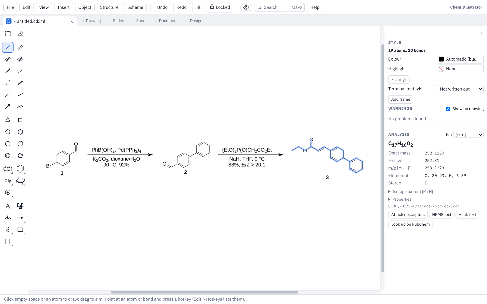

# Getting started

This page covers installing Chem Illustrator, finding your way round the window, opening your first ChemDraw file, saving, and the Preferences window.

Chem Illustrator is free. It draws structures the way ChemDraw does (the same hotkeys, the same ACS Document 1996 look) and opens and saves ChemDraw's `.cdxml` and `.cdx` files. Next to drawings it also has slides, sheets, documents and designs, each in its own tab.

A note on keys: this guide writes Ctrl, as on Windows and Linux. On a Mac, use Cmd wherever it says Ctrl, and Option wherever it says Alt.

## Installing

Download the newest installer from the **Releases** page of the project on GitHub: <https://github.com/nathanohare/Chem-Illustrator/releases>. The newest release is at the top. Open its **Assets** list and pick the file for your computer.

### Windows

1. Download the file ending in `x64-setup.exe` and run it.
2. Windows may say **"Windows protected your PC"**. This is Windows SmartScreen: it warns about any program that has not been signed with a paid Windows certificate. Click **More info**, then **Run anyway**.
3. Follow the installer. A newer installer can be run over an older version; you don't need to remove the old one first.

The installer puts the app in your own user folder, so it doesn't need administrator rights. On a computer managed by an IT department, their rules may still block programs that aren't signed; if so, ask them, since neither the installer nor the portable copy below gets round those rules.

### Windows, without installing (portable copy)

A portable copy runs from a flash drive or any folder, with nothing installed, and keeps its settings with it.

1. Download the file ending in `x64-portable.zip`.
2. Right-click it, choose **Extract All…**, and put the **Chem Illustrator** folder wherever you want it: a flash drive, Documents, the desktop.
3. Open the folder and double-click **Chem Illustrator.exe**. The first time, SmartScreen may warn as described above.

The **Chem Illustrator Data** folder next to the app is what makes it portable: your hotkeys, preferences, styles, templates and recent files are saved there instead of on the computer, so the copy behaves the same on every computer you plug it into. Keep the two together, and copy both to move your copy. **Help ▸ Hotkeys and Tips** shows "(portable)" after the version number.

Updates work as in an installed copy, except that **Install and Restart** replaces Chem Illustrator.exe in its folder rather than installing anything. If the drive can't be written to (locked, or read-only), the app says so and keeps its settings on the computer for that session.

The app needs the Microsoft Edge WebView2 Runtime, which Windows 10 and 11 already have. The only thing a portable copy leaves on the computer is WebView2's cache in `%LOCALAPPDATA%\io.github.nathanohare.chemillustrator`, which holds none of your work or settings.

On macOS and Linux, a folder named **Chem Illustrator Data** next to the app (or the AppImage) has the same effect. On a Mac, the app keeps its normal settings folder until the "damaged" step below has been done, because macOS runs a downloaded app from a hidden copy until then.

### macOS

Works on Apple silicon and Intel Macs, macOS 11 or newer.

1. Download the file ending in `universal.dmg`, open it, and drag **Chem Illustrator** into **Applications**.
2. The first time you open it, macOS (Gatekeeper) says it can't check the app, because it isn't signed with an Apple Developer certificate. To open it anyway:
   - open **System Settings ▸ Privacy & Security**, scroll down, and click **Open Anyway** next to Chem Illustrator;
   - on older versions of macOS, right-click (or Control-click) the app in Applications and choose **Open**.
3. If macOS says instead that the app **"is damaged"**, open the Terminal app and run this line once, then open the app again:

   ```
   xattr -cr "/Applications/Chem Illustrator.app"
   ```

You only need to do this once; after that the app opens normally.

### Linux

Three kinds of file are offered:

- **`.AppImage`**: runs on most distributions. Make it executable (in your file manager's Properties, or `chmod +x` on the file), then double-click it. The AppImage keeps itself up to date.
- **`.deb`** (Ubuntu, Debian) and **`.rpm`** (Fedora): install them like any other package. To update, download and install the newer one.

### Updates

A few seconds after it starts, the desktop app checks whether a newer version has been released. If there is one, a small message says which version is ready and what changed, and offers:

- **Install and Restart**: downloads it, installs it and restarts the app. If any tab has unsaved changes, you are warned first so you can cancel and save.
- **Later**: closes the message for now.
- **Skip This Version**: stops asking about this one version.

Each update is checked against the project's signing key before it installs, so only genuine releases are accepted. You can look for an update at any time with **File ▸ Check for Updates…**, and turn the automatic check off in **Edit ▸ Preferences**.

## A tour of the window



### The menu bar

Along the top are the menus: **File**, **Edit**, **View** and **Insert**, then the menus for the kind of tab you are in. In a drawing these are **Object**, **Structure** and **Scheme**; slides add a **Slide** menu and sheets a **Sheet** menu. Documents, sheets, slides and designs also have a ribbon of buttons under the menu bar, like Word, Excel and PowerPoint.

To the right of the menus are:

- **Undo**, **Redo** and **Fit** (fit the whole drawing in the window);
- **Locked**, which locks or unlocks all the toolboxes at once so they can be moved (each toolbox also has its own padlock; see [Drawing](drawing.md#toolboxes-and-my-toolbox));
- the **eye button**, which turns the dark page on and off;
- the **Search** box;
- **Help**, which lists the hotkeys and gives short notes on each part of the program.

The menus show each command's key beside it, so they are a good way to learn the shortcuts.

### Tabs

Each open file has a tab under the menu bar, with its own icon and colour for its kind (blue for drawings, orange for slides, green for sheets, dark blue for documents, purple for designs). Ctrl+Tab and Ctrl+Shift+Tab move between tabs, and Ctrl+W closes one.

At the end of the tabs are buttons to start something new:

| Button | Opens | Like |
|---|---|---|
| **+ Drawing** | A new drawing | ChemDraw |
| **+ Slides** | A new slide deck | PowerPoint |
| **+ Sheet** | A new spreadsheet, with chemistry functions | Excel |
| **+ Document** | A new document with pages, styles and references | Word |
| **+ Design** | A TOC graphic, graphical abstract, poster or flowchart | a graphics program |

The same commands are in the **File** menu (**New Drawing**, **New Slides**, **New Sheet**, **New Document**, **New Design…**). To change the tab colours, use **View ▸ Mode Colours…**.

### The toolbox on the left

In a drawing, the drawing tools run down the left side: select, eraser, bonds, rings, templates, text, the periodic table, mass fragmentation, arrows, mechanism symbols, shapes and brackets. A button with a small arrow holds a set of related tools: click the arrow (or right-click the button) to see them all. Rest the mouse on any button to see its name and hotkey. [Drawing](drawing.md) explains each tool.

### The side panel on the right

The panel on the right changes with what you are doing. In a drawing it has:

- **Style**: the look of whatever is selected (line widths, colours, fonts, fills, and the settings of a single atom or bond).
- **Warnings**: possible problems in the structures, such as a carbon with five bonds (see [Drawing](drawing.md#warnings)).
- **Analysis**: formula, masses and more for the selected structure (see [Drawing](drawing.md#the-analysis-panel)).

The **›** arrow at the top of the panel folds it away to give the drawing more room (also **View ▸ Fold Side Panel**). Each kind of tab remembers this on its own, so you can keep the panel folded in sheets and open in drawings.

### The hint line at the bottom

The line along the bottom of the window tells you what the tool you have picked does, and which keys change it. For example, with the select tool it says that Shift or Ctrl+click adds to the selection and Ctrl+drag copies. Look there when you try a tool for the first time.

### Search (Alt+Q)

Click **Search** at the top, or press Alt+Q, and type a few letters of what you want to do: `wedge`, `number comp`, `bold`, `dark`. The list shows each matching menu command, ribbon button and drawing tool, where it lives and its key. Press Enter for the top match, or use the arrow keys to pick another. With nothing typed, the commands you used lately come first. **Edit ▸ Search Commands…** opens the same box.

## Opening your first ChemDraw file

1. Choose **File ▸ Open…** (Ctrl+O).
2. Pick a `.cdxml` or `.cdx` file. It opens in a new tab.

You can also drag a file from your file manager and drop it on the window. The Open window also takes PowerPoint (`.pptx`), Word (`.docx`), Excel (`.xlsx`), CSV and SD files, each in the right kind of tab.

In the desktop app, **File ▸ Recent** lists the last ten files you opened or saved. **Clear Recent Files** at the bottom of the list empties it.

### Copying from ChemDraw

In the Windows app you can copy structures in ChemDraw and paste them here with Ctrl+V, and copy from here and paste into ChemDraw as structures. Ctrl+V also takes a SMILES string or a molfile copied as text.

## Saving

- **File ▸ Save** (Ctrl+S) saves the tab. A drawing is saved as `.cdxml` unless you choose `.cdx`.
- **File ▸ Save As…** (Ctrl+Shift+S) saves a copy under a new name or in the other format.

When you save a ChemDraw file you opened here, only the parts you changed are rewritten. Everything else stays exactly as ChemDraw wrote it, so the file still opens in ChemDraw as before.

Other ways to get a drawing out:

- **File ▸ Export PDF…** saves a PDF.
- **File ▸ Export Picture…** saves a PNG at the resolution you choose (300 or 600 dpi for journals) or an SVG, on the page colour or see-through.
- **File ▸ Export Molfile…** saves the selected structures (or all of them) as a `.mol` file.
- **File ▸ Print…** (Ctrl+P) prints on Letter or A4, at actual size or as large as fits.
- **Edit ▸ Copy** (Ctrl+C) copies the selection, or the whole drawing when nothing is selected. In the Windows app it pastes into Word and PowerPoint as a sharp picture. **Edit ▸ Copy as SMILES** (Ctrl+Alt+C), **Copy as Molfile Text** (Ctrl+Alt+O) and **Copy as CDXML Text** (Ctrl+D) copy text instead.

Slides, sheets, documents and designs save in their own formats; see their pages. To save every open tab together, see **File ▸ Save Workspace** in [Files and sharing](files-and-sharing.md).

## Edit ▸ Preferences

**Edit ▸ Preferences…** holds a few choices that apply everywhere:

| Setting | What it does |
|---|---|
| **Terminal methyls written as** | Me or CH3, for **Chemistry ▸ Labels and Numbers ▸ Show Terminal Methyls**. Methyls already written out in the selection change too. |
| **Axial chirality written as** | Ra / Sa, or P / M (helicity). Ra is the same as M, and Sa as P. |
| **Charges from the + and − keys** | A plain sign (N+) or a circled one (⊕, ⊖). Charges already drawn keep their look. |
| **Ask before changing every structure on the page when nothing is selected** | Some commands, such as Show Terminal Methyls, act on the whole page when nothing is selected. With this ticked, they ask first. |
| **Check for a newer version when the app starts** | The automatic update check (desktop app only). |
| **Look up names the name reader can't read on PubChem** | Lets **Name to Structure** send a name it can't read itself (DMAP, Hünig's base) to PubChem. Untick it to keep everything on your computer. |
| **Your name on tracked changes in documents** | The name shown on your edits when tracking changes. |

Your preferences, hotkeys, own templates, nicknames, palettes and toolbox layout are kept in a small settings file, `settings.json`. **Edit ▸ Hotkeys…** shows where it is on your computer.

---

Next: [Drawing](drawing.md) · [Keyboard and mouse](keyboard-and-mouse.md) · [Slides](slides.md) · [Documents](documents.md) · [Sheets](sheets.md) · [Design](design.md) · [Files and sharing](files-and-sharing.md) · [Feedback](feedback.md)
