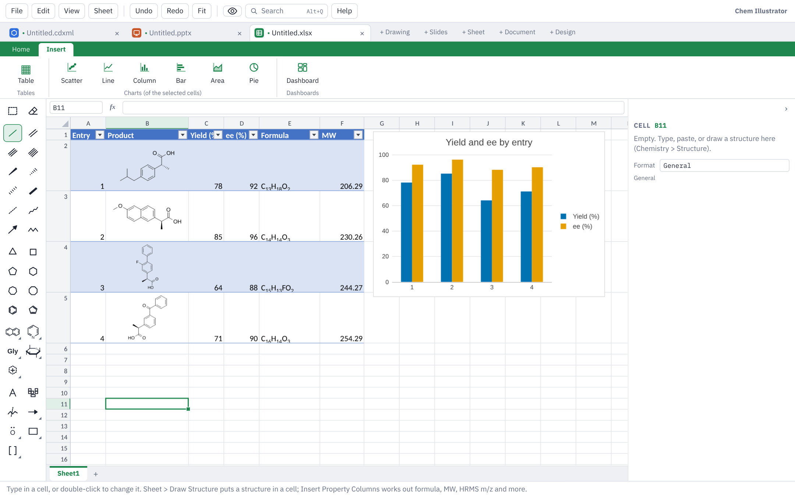

# Sheets

This page covers Sheet mode: cells and formulas, structures in cells, the chemistry functions, formatting, charts and isotope patterns, dashboards, and saving for Excel.

## Starting a sheet

Click **+ Sheet** at the end of the tab strip, or choose **File ▸ New Sheet**. While a sheet is showing, Ctrl+N starts another one.

The ribbon has **Home** and **Insert** tabs. **Table Design**, **Chart** and **Dashboard** tabs appear when you click in a table, a chart or a dashboard. The **Sheet** menu at the top holds most of the same commands.

## Working with cells

Cells work as in Excel:

- Type, then Enter or Tab. F2 or a double-click edits a cell. The arrow keys, Ctrl+arrow, Ctrl+Z and Ctrl+Y work as you expect.
- Drag column and row borders to resize them. The worksheet tabs at the bottom switch sheets; Shift+F11 adds one.
- Drag the small square at the corner of the selection to fill. Compound numbers count on: drag **2a** down for 2b, 2c…, or **S1** for S2, S3. Hold Ctrl while dragging to copy instead. Ctrl+D and Ctrl+R fill down and right.
- **Home** tab ▸ **Insert** and **Delete** add or remove rows, columns and worksheets.
- **Find…** (Ctrl+F) searches the text in cells.

## The chemistry toolbox

The drawing toolbox shows on the left in Sheet mode too. Pick a drawing tool there and the selected cell's structure opens for editing with that tool; if the cell is empty, a new drawing starts for it. Press **Done** above the drawing to put the structure in the cell.

When the pointer turns into a pointing hand over a cell, that cell holds a structure you can open: double-click it to change the drawing.

## Structures in cells

- **Draw one:** select a cell and click **Home** tab ▸ **Structure** (or **Insert ▸ Structure in Cell**). The drawing tools open; draw, press **Done**, and the structure sits in the cell.
- **From names or SMILES:** type a column of names or SMILES, select them and click **From Name** (Ctrl+Shift+N). Each one is drawn in a new column beside it.
- **Paste:** copy a structure from a drawing tab, or from ChemDraw (Windows app), and paste it into a cell.

### Property columns

Click in your table and choose **Home** tab ▸ **Properties** (or **Insert ▸ Insert Property Columns…**). Tick the columns you want:

Formula, MW, Exact mass, HRMS m/z, cLogP, TPSA, H-bond donors, H-bond acceptors, Rotatable bonds, SMILES, InChIKey and **Duplicate of**.

Each column fills itself in for every row and updates when you change a structure. **Duplicate of** names the first other row with the same compound (same InChIKey), so a compound entered twice shows straight away.

Any calculated value can be typed over, for example with a measured mass. The cell is marked as typed over, and **Reset to Calculated** puts the calculated value back.

### Reagent tables

**Home** tab ▸ **Reagent Table** (or **Insert ▸ New Reagent Table**) adds a worksheet set up for a reaction. Type the limiting reagent's mmol, then for each reagent draw its structure (or type its SMILES) and its equivalents. MW, mmol and mass (mg) work themselves out; type a density (g/mL) or a concentration (M) and the volume (µL) appears. Any number can be typed over, for example the MW of a salt or hydrate, and the rest of the row follows.

## Formulas

Type `=` to start a formula. References with `$`, references to other sheets and **Σ AutoSum** (Alt+=) work as in Excel.

Common functions include `SUM`, `AVERAGE`, `MIN`, `MAX`, `MEDIAN`, `STDEV`, `COUNT`, `COUNTA`, `ROUND`, `IF`, `IFERROR`, `AND`, `OR`, `CONCATENATE`, `LN`, `LOG10`, `EXP`, `SQRT`, and the line-fit functions `SLOPE`, `INTERCEPT`, `RSQ`, `STEYX` and `FORECAST`. Not every Excel function is available; one that isn't shows an error in its cell.

### Chemistry functions

The first argument is a cell holding a structure, or SMILES in quotes.

| Function | Gives |
|---|---|
| `=FORMULA(B2)` | Molecular formula (Hill order) |
| `=MW(B2)` | Molecular weight, g/mol |
| `=EXACTMASS(B2)` | Monoisotopic mass |
| `=HRMS(B2,"[M+Na]+")` | m/z of an ion ([M+H]+ if you give none) |
| `=CLOGP(B2)`, `=TPSA(B2)` | cLogP and TPSA |
| `=HBD(B2)`, `=HBA(B2)`, `=ROTB(B2)` | H-bond donors, acceptors, rotatable bonds |
| `=SMILES(B2)`, `=INCHIKEY(B2)` | Canonical SMILES, standard InChIKey |
| `=DUPLICATE(B2,B:B)` | Another row with the same compound, or blank |
| `=ISOMZ(B2,"[M+H]+",2)` | m/z of the M+2 peak of that ion |
| `=ISOABUND(B2,"[M+H]+",2)` | Height of that peak, as % of the tallest |

For `ISOMZ` and `ISOABUND`, the compound can also be a formula in quotes (`"C9H8O4"`). The last number is the peak: 0 for M, 1 for M+1 and so on. Past the last peak they give a blank. A charged structure is its own ion, whatever adduct you give.

You can combine them as usual: `=1000*D2/MW(B2)` turns mg into mmol.

## Formatting

- **Home** tab: font size, bold, italic, underline, borders, fill and text colour, alignment, **Wrap**, **Merge**, and the number format with **+.0** and **−.0** for decimal places. **Other…** in the number format list takes your own Excel-style format, such as `0.00 "mg"`.
- **C₉H₈** sets formulas with proper subscripts.
- **Units:** the number format list has a **Units** group for reaction conditions: temperature (°C), catalyst loading (mol%), equivalents, concentration (M), density (g/mL), amount (mmol), mass (mg), volume (mL and µL), time (h and min), pressure (atm) and % ee. The cell keeps the plain number, so it still sorts and works in formulas. Typing "-78 °C" or "5 mol%" into a cell sets the unit for you.

### Conditional formatting

Select some numbers and open **Home** tab ▸ **Conditional Formatting**. Choose a colour scale, data bars, an icon set, or a rule that highlights cells (greater than a value, containing some text, top or bottom values, above or below average, duplicates, empty cells, or your own formula). **Manage Rules…** lists every rule so you can edit, reorder or delete them.

### Table styles

Click in your data and choose **Home** tab ▸ **Format as Table** (or **Insert** tab ▸ **Table**). The **Table Design** tab then offers the table's name, **Header Row**, **Totals Row**, **Banded Rows**, first and last column, banded columns, the **Table Style**, its colours, and **Convert to Range** to make it plain cells again.

## Sort, filter and freeze

- **Sort ↑** and **Sort ↓** sort the table by the current column. Structures move with their rows.
- **Filter** (Ctrl+Shift+L) puts buttons in the header row. Each one sorts, picks values to show, or keeps rows that match a condition such as "less than 500" or "containing Br".
- **By Substructure** opens the drawing tools: draw the part to look for, and only rows whose structure contains it stay.
- **Freeze Header** keeps the header rows in view as you scroll.

## Charts

Select a block of cells and choose **Insert** tab ▸ **Scatter**, **Line**, **Column**, **Bar**, **Area** or **Pie**. Click a chart to open the **Chart** tab; double-click it, or click **All Settings**, for every setting in the panel on the right.

- **Change Type** and **Add Series…** change what is plotted.
- **Titles…**, **Legend**, **Colours**, **Axes…** (limits, log scale, grid lines, number format) and **Data Labels**. Titles take subscripts and superscripts: `k_{obs}` and `s^{-1}`.
- **Error Bars**.
- **Fit Line**: straight line, polynomial (x² or x³), exponential, logarithmic or power. The equation and R² appear in an empty corner of the chart, and you can drag the label. In the panel, **Put in cells…** writes the slope, intercept, R² and standard error to the sheet as live formulas.
- **Copy as Picture** to paste the chart into Word, PowerPoint or a document or slide here; **Save as Picture…** for a PNG or SVG; **Delete Chart**.

### Stick spectra

In the chart panel, each series of a scatter chart has **Sticks** (peaks drawn up or down from zero, as in a mass spectrum) and **Show x (m/z)** to label each peak with its value. You can use these for any spectrum you put in a sheet.

## Isotope patterns

To compare a measured HRMS isotope pattern with the calculated one:

1. Put the compound in a cell: draw a structure, or type SMILES or a formula such as `C14H12BrNO`.
2. With that cell selected, choose **Home** tab ▸ **Isotopes** (or **Insert ▸ Isotope Pattern…**, or the right-click menu).
3. Fill in the window:
   - **Compound:** the cell you are on, or a formula typed in.
   - **Ion:** [M+H]+ to start; pick another or type any adduct ([M+Na]+, [M−H]−, [M+2H]2+…).
   - **List peaks down to:** 0.5% of the tallest peak; lower it to list more small peaks.
   - **Columns for the peaks found, with the error in ppm.**
   - **Chart:** found above and calculated below (a mirror plot), found and calculated together, calculated only, or no chart.
4. Click **Insert**. A table appears beside your data, with one row per peak (M, M+1, M+2…) and its calculated m/z and height.
5. Type the m/z and heights from your spectrum into **Found m/z** and **Found (%)**. **Error (ppm)** fills itself in, and the chart's found peaks appear as you type.

The **Ion** cell in the table can be changed (to `[M+Na]+`, say), and the calculated columns and chart follow. Change the structure and the table follows too.

## Dashboards

A dashboard is a page of tiles that summarise a table: useful for a catalyst screen or a substrate scope. Add one with **Insert** tab ▸ **Dashboard**, or right-click a sheet tab ▸ **Insert Dashboard**. The **Dashboard** tab then adds tiles:

| Tile | What it shows |
|---|---|
| **Chart** | A chart of a table's columns. **Same labels** combines rows with the same label (average, sum, count…), for one bar per ligand rather than one per reaction |
| **Number** | One headline number (KPI): average, sum, median, smallest, largest, standard deviation, or a count; or any formula. A **Target** colours it green or red, and you choose whether higher is better |
| **Table** | Chosen columns, sortable by clicking a heading; structures are drawn |
| **Slicer** | A button for each value of a column (catalyst, solvent…). Clicking buttons filters every tile fed by the same table |
| **Gallery** | A card for each drawn structure in a table, with values such as the ID and yield under it |
| **Text** | A heading or a note |

Each new tile asks which table or block of cells to read. For a gallery, the structures need to be in a table made with **Format as Table**.

- **Move and resize:** drag a tile, or drag its bottom-right corner. Tiles snap to a grid. With a tile picked, the arrow keys move it, Shift+arrows resize it and Delete removes it.
- **Settings:** click a tile for its settings in the right-hand panel; click an empty spot, or **Dashboard Settings**, for the dashboard's columns, row height, gap and background.
- **Slicers:** click more buttons to pick several, and click a picked one again to drop it. Several slicers apply together. The ✕ on a slicer, or **Clear Filters**, shows everything again.

## Saving and sharing

- **Save** (Ctrl+S) writes an Excel workbook (.xlsx). In Excel, structures are pictures with their SMILES in the cell, properties are plain numbers, and charts, trendlines, conditional formatting and tables are Excel's own. Stick spectra show as sticks in Excel too.
- Excel has no dashboards, so it gets a plain version: each chart tile becomes a real Excel chart showing what the tile shows, and numbers, tables and text become cells.
- Excel has no `ISOMZ`, `ISOABUND` or other chemistry functions, so the saved file keeps their values.
- Open the .xlsx here again and the structures, chemistry formulas and full dashboard come back, even after Excel has saved the file.
- **Save As** also writes a CSV file or an SD file (.sdf). These keep only the values of the sheet showing.
- **File ▸ Open** reads .xlsx, .csv and SD files. An SD file gives one row per structure, with its data fields as columns.
- Copy cells here and paste into Excel to get the values, with SMILES for structures. Cells copied in Excel paste here.
- **File ▸ Print…** (Ctrl+P) prints the whole sheet or the selected cells, portrait or landscape, with or without gridlines. Structures print as pictures.

Next: [Getting started](getting-started.md) · [Drawing](drawing.md) · [Keyboard and mouse](keyboard-and-mouse.md) · [Slides](slides.md) · [Documents](documents.md) · [Design](design.md) · [Files and sharing](files-and-sharing.md) · [Feedback](feedback.md)
