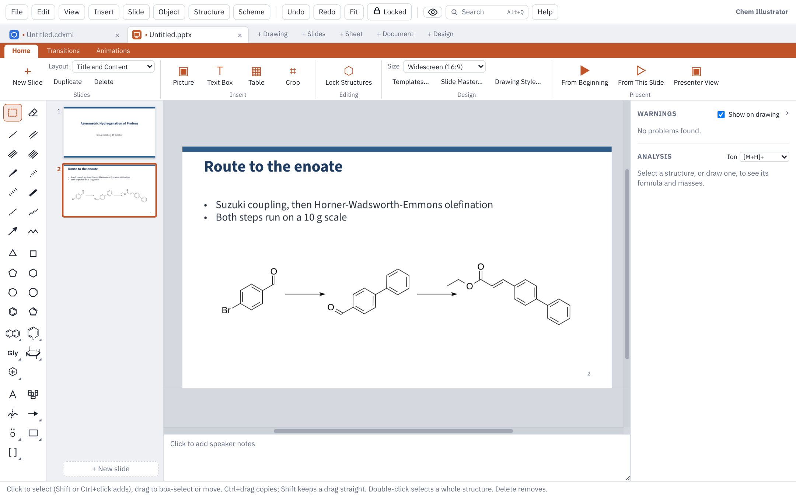

# Slides

This page covers Slides mode: building a deck, the slide master and templates, chemistry on slides, pictures, transitions and animations, presenting, printing handouts and saving for PowerPoint.

## Starting a deck

Click **+ Slides** at the end of the tab strip, or choose **File ▸ New Slides**. While a deck is showing, Ctrl+N starts another one. Each open file has its own tab: Ctrl+Tab moves between tabs and Ctrl+W closes one.

The Slides ribbon has PowerPoint's tabs: **Home** (slides, font, paragraph), **Insert** (pictures, text boxes, tables, shapes), **Design** (size, templates, slide master, drawing style), **Transitions**, **Animations** and **Slide Show**. The **Slide** menu at the top holds the same commands.

## Slides and layouts

- **New slide:** Ctrl+M, **Home** tab ▸ **New Slide**, or **+ New slide** under the slide list. The new slide goes after the current one.
- **Layout:** pick one from **Layout** on the **Home** tab or the **Slide** menu: Title Slide, Title and Content, Two Content, Title Only or Blank.
- **Text:** click "Click to add title" (or any placeholder) and type. Lists and the chemistry typing helpers work as in any text box, so CH2Cl2 gets its subscripts.
- **Slide size:** **Design** tab ▸ **Size**, or **Slide ▸ Widescreen (16:9)** / **Standard (4:3)**.
- **Speaker notes:** type them in the box under the slide. A slide with notes shows a small mark in the slide list.

### The slide list

The list down the left shows every slide.

| To do this | Do this |
|---|---|
| Move a slide | Drag it up or down |
| Pick several | Ctrl+click or Shift+click |
| Delete the picked slides | Delete, or **Home** tab ▸ **Delete** |
| Duplicate the picked slides | Ctrl+D, or **Home** tab ▸ **Duplicate** |
| Go to the next or previous slide | Page Down / Page Up |

## The slide master

**Design** tab ▸ **Slide Master…** (or **Slide ▸ Slide Master…**) sets the look of every slide at once:

- **Background:** colour, the template's shapes and its accent colours.
- **Title slides:** their own background and text colours, if you want them different.
- **Titles** and **Text:** font, size, colour and bold; a separate size for subtitles.
- **Logo:** a picture in any corner, at the width you choose.
- **Slide numbers and footer:** on or off, also on title slides if you like, with the footer's size and colour.
- **Structures:** the bond length structures are drawn at, and whether pasted structures are resized to it.

Click **Apply to all slides**. Text you formatted by hand keeps its own formatting. Ctrl+Z puts the old settings back in one step.

## Design templates

**Design** tab ▸ **Templates…** (or **Slide ▸ Templates…**) offers 21 ready-made looks in three groups: **Light**, **Dark title slide** and **Bright**. Picking one changes the fonts, colours, background and the shapes behind every slide. Your text, structures and pictures stay where they are, and Undo puts the old look back.

Tick **Also start new slide decks with the template I pick** to make it the starting look for new decks. You can change any part of a template afterwards with **Slide Master…**.

## Text

Click a placeholder or a text box to type in it. **Insert** tab ▸ **Text Box** makes a new one: click to type, or drag to make a box that wraps.

The **Font** and **Paragraph** groups on the **Home** tab work as in PowerPoint. While you are typing they change the selected words (or what you type next); with a text box or a shape picked, they change all of its text at once.

- **Font:** font, size, **A+** and **A−** (bigger and smaller in PowerPoint's steps), bold, italic, underline, subscript, superscript, formula style (CH₂Cl₂ with the numbers lowered) and colour.
- **Paragraph:** bullets, numbering, list level (or indent), line spacing, and lining up left, centre, right or both edges.

The small bar that appears above text while you type has the same buttons, plus Greek letters and symbols and the paragraph spacing.

## Shapes

**Insert** tab ▸ **Shapes** opens the shape library: basic shapes, block arrows, flowchart shapes, callouts and lab glassware. Type in its box to find one (for example "flask"). Click a shape, then click on the slide to place it at its usual size, or drag to draw it the size you want. Double-click a shape to type in it. Its fill, outline and text are in the **Style** panel, and shapes save to PowerPoint as PowerPoint's own shapes where it has a matching one.

## Structures on slides

Every drawing tool in the toolbox works on a slide: draw structures, use the ChemDraw-style hotkeys, add reaction arrows, run Clean Up, and see R/S labels and warnings as you would in a drawing. You can also:

- copy a scheme from a drawing tab (or from ChemDraw, in the Windows app) and paste it onto a slide, or the other way round;
- choose how structures look on every slide with **Design** tab ▸ **Drawing Style…** (a journal's style, or your own);
- click **Home** tab ▸ **Lock Structures** so clicks pass through structures, which makes text and pictures near them easier to pick. Click it again to edit structures.

To put a drawing beside your slides while you work, see Split View in [Files and sharing](files-and-sharing.md).

## Pictures

- **Add a picture:** **Insert** tab ▸ **Picture**, paste one, or drag a file onto the slide.
- **Resize:** drag a corner. The **Style** panel on the right takes an exact width and height, with **Keep proportions** and **Original size**.
- **Crop:** **Insert** tab ▸ **Crop**, then drag the black handles and press Esc. The panel also takes exact crop amounts for each side, and **Uncrop** shows the whole picture again.
- **Spectra:** in the Windows app, a spectrum copied from MestReNova pastes as lines and text, so it stays sharp when you zoom. A spectrum saved as an .emf file works the same way with **Picture** or by dropping the file.

### Videos

An animated reaction can go on a slide as a video: in Slides mode, open **Scheme ▸ Animate Reaction…** and click **Put on Slide** (see [Animating a reaction](drawing.md#animating-a-reaction)). The video shows a play mark while you edit, plays on its own and loops in the slide show, and is saved into the .pptx as a PowerPoint video that starts by itself. On slides that have their own animations, PowerPoint plays it when clicked.

### Frames, rounded corners and shadows

Select a picture, then use the **Style** panel: **Frame style**, frame line and colour, **Rounded corners (%)** and **Shadow** (None, Soft or Hard). For a ready-made look, right-click the picture and choose **Picture Style**. These looks are kept when you save to PowerPoint.

## Tables

**Insert** tab ▸ **Table** (or **Insert ▸ Table…**) puts an ACS-style table on the slide. Double-click a cell to type; Tab moves to the next cell. The **Style** panel adds and removes rows and columns, sets heading rows, lines, column widths, a title and footnotes. Cells copied from Excel, Word or a sheet paste as a new table.

## Transitions

Open the **Transitions** tab.

1. Pick **Fade**, **Push**, **Wipe** or **Cover**.
2. **Effect** sets the direction.
3. **Speed** sets how fast, or type any **Duration** in seconds.
4. **After … s** moves on to the next slide by itself after that time (once the slide's animations have played).
5. **Apply To All** gives every slide this slide's transition, speed and timing.
6. **Preview** plays the slide coming in.

## Animations

Open the **Animations** tab, select something on the slide (a structure, picture, text box, shape or table), then pick an effect:

- **Coming in:** Appear, Fade, Wipe or Fly In.
- **Going out:** Disappear, Fade Out, Wipe Out or Fly Out.

The same effects are on the right-click menu under **Animation**. Each animation has its own settings on the ribbon:

| Setting | What it does |
|---|---|
| **Start** | On Click, With Previous or After Previous |
| **Speed** or **Duration** | How long it takes |
| **Delay** | Seconds to wait before it starts |
| **Effect** | The side it comes from or goes to (Wipe and Fly) |
| **▲ Earlier** / **▼ Later** | Change its place in the order |
| **Remove** | Take it off |

A reagent written over an arrow animates with its whole scheme, because the scheme is a single picture in PowerPoint.

### The Animation pane

**Animations** tab ▸ **Animation Pane** (or **Slide ▸ Animation Pane**) lists the slide's animations in the right-hand panel. The numbers are clicks, and small numbered tags beside the objects on the slide show which click brings each one in.

- Click a row to select its object.
- Drag rows, or use ▲ and ▼, to change the order.
- × removes an animation.

**Preview** on the Animations tab (or **Slide ▸ Preview Slide**) plays the slide's transition and animations. Undo and redo work for every change.

## Comments

**Review** tab ▸ **New Comment** (Ctrl+Alt+M, **Slide ▸ New Comment**, or right-click ▸ **New Comment**) pins a note to the slide, beside what is selected or in the slide's top corner. The **Comments** pane opens in the right-hand panel with a card to type in; press Enter to save it.

- Each comment shows on the slide as a small marker with the writer's initials and its number. Drag a marker to move it; click it to see its card.
- On a card: **Reply**, **Resolve** (greyed until deleted; **Reopen** brings it back), **Edit** and **Delete**.
- **◀ Previous** and **Next ▶** step through every comment in the deck, going to each one's slide. **Delete All on Slide** clears the slide being edited.
- **Show Comments** hides or shows the markers and the pane. Markers are only on screen: they are never shown in the slide show, in pictures or in print.

Undo works for every change. Comments are saved in the .pptx as PowerPoint comments, with their replies, so PowerPoint, Keynote and Google Slides show them. Comments added in PowerPoint (old or new style) open here too.

## Giving the show

| To do this | Press |
|---|---|
| Start from the first slide | F5, or **Slide Show** tab ▸ **From Beginning** |
| Start from this slide | Shift+F5, or **Slide Show** tab ▸ **From This Slide** |
| Next click or slide | Click, →, Space or Enter |
| Back one click | ← or Backspace |
| Jump to a slide | Type its number, then Enter |
| Black or white screen | B or W (any key brings the slide back) |
| End the show | Esc |

Each click plays the next animation, then moves on to the next slide with its transition. A click while something is moving finishes it at once.

### Presenter View

**Slide ▸ Presenter View**, **Slide Show** tab ▸ **Presenter View**, or Alt+F5.

With a second screen or projector set to extend the desktop, the slides fill the second screen. Your own screen shows:

- the slide on show and the next slide;
- your speaker notes (**A−** and **A+** change their size);
- a timer (**Pause** and **Reset**) and the clock;
- **Back** and **Next**, **Black Screen**, **Audience Window** and **End Show**.

Animations play on both screens. B and W blank the audience's screen. Esc or **End Show** closes the audience's window and takes you back to editing on the slide you ended on.

With only one screen, the audience's slides open in a window of their own. Drag it to a projector when one is plugged in, or close it to rehearse; **Audience Window** opens it again. In a web browser, press F in that window to fill the screen.

## Printing handouts

**File ▸ Print…** (Ctrl+P) asks for a layout:

- **Full page slides**, one to a page;
- **Handouts** with 2, 3, 4, 6 or 9 slides a page. Three a page leaves lines beside each slide for notes.

For handouts you can also pick the paper and **Frame the slides**. The system's Print window then picks the printer and copies, and can save a PDF.

## Saving and sharing

- **Save** (Ctrl+S) writes a PowerPoint file (.pptx).
- In PowerPoint, titles, text boxes and lists are ordinary PowerPoint text, tables are PowerPoint tables, and transitions and animations are PowerPoint's own. Structures show as sharp pictures.
- Open the same .pptx here again (Ctrl+O) and the structures are editable drawings again, even after PowerPoint has saved the file.
- The free fonts that come with the app are saved inside the file when you use them, so the deck looks the same on a computer that doesn't have them.
- **File ▸ Export PDF…** makes a PDF with one page per slide.
- **File ▸ Export Picture…** saves the current slide as a PNG at the dpi you choose, or as an SVG.

Opening a deck made in PowerPoint works too. A ChemDraw object embedded in a PowerPoint slide comes in as a picture, not an editable structure. More on file types in [Files and sharing](files-and-sharing.md).

Next: [Getting started](getting-started.md) · [Drawing](drawing.md) · [Keyboard and mouse](keyboard-and-mouse.md) · [Documents](documents.md) · [Sheets](sheets.md) · [Design](design.md) · [Files and sharing](files-and-sharing.md) · [Feedback](feedback.md)
